# cadeloop

**A fast asyncio event loop and ASGI web server for CPython 3.11, 3.12 and 3.13, written in Rust.**
Runs on Windows and Linux.

[](https://pypi.org/project/cadeloop/)
[](https://github.com/cadezawacki/cadeloop/actions/workflows/ci.yml)
[](LICENSE)
[](https://pypi.org/project/cadeloop/)
[](#install)

cadeloop does two jobs, and you can use either one on its own.

**It is an asyncio event loop.** Put it under code you already have, such as
asyncio scripts, aiohttp, websockets clients or uvicorn, and that code runs
on cadeloop instead of the standard library loop. Nothing else in your code
changes.

```python
import asyncio
import cadeloop

cadeloop.install()   # from here on, asyncio runs on cadeloop
asyncio.run(main())
```

**It is an ASGI web server.** `cadeloop.serve()`, or the `cadeloop` command,
runs FastAPI, Starlette and other ASGI apps with the HTTP work done in Rust:
parsing requests, building the `scope` your app receives, and encoding the
response. The only Python left on a request's path is your app.

```bash
cadeloop main:app --host 0.0.0.0 --port 8000
```

On a plaintext benchmark on Windows 11, `cadeloop.serve()` answered 4.3 times
as many requests per second as uvicorn on winloop, at a quarter of the CPU
per request. On Linux it answered 4.5 times as many as `uvicorn[standard]`
(httptools on uvloop) and 2.9 times as many as granian. A bare benchmark app
flatters every server; with a FastAPI route and a pydantic model in each
request, the same lead is 1.5 to 1.6 times. Details are under
[benchmarks](#benchmarks).

New to event loops? [How cadeloop works](docs/learn/README.md) is a short,
illustrated tour that starts from the basics.

---

## Contents

- [Install](#install)
- [Quick start](#quick-start)
- [Which part should I use?](#which-part-should-i-use)
- [Using cadeloop with FastAPI](#using-cadeloop-with-fastapi)
- [Benchmarks](#benchmarks)
- [Event loop mode: reference](#event-loop-mode-reference)
- [Server mode: reference](#server-mode-reference)
- [Settings in both modes](#settings-in-both-modes)
- [Recipes](#recipes)
- [How it works](#how-it-works)
- [Development](#development)
- [License](#license)

---

## Install

```bash
pip install cadeloop
```

| | |
|---|---|
| Python | CPython 3.11, 3.12 or 3.13 |
| OS | Windows 10 or 11, or Linux (glibc 2.17 or newer) |
| CPU | x86-64 |

Wheels are published for Windows x64 and Linux x64 (manylinux2014), one
per Python version, with a source distribution for everything else. 3.11
is the version cadeloop is developed and benchmarked on; 3.12 and 3.13 run
the same test suites, and on each cadeloop behaves as that version's
asyncio does where they differ
([Python versions](docs/compatibility.md#python-versions)). To check an install, print the
version and the backend the loop picked:

```bash
python -c "import cadeloop; l = cadeloop.new_event_loop(); print(cadeloop.__version__, l.stats()['backend']); l.close()"
```

It prints `iocp` on Windows and `epoll-dev` on Linux after the version.

---

## Quick start

### Make existing asyncio code faster

Call `cadeloop.install()` once, before anything creates an event loop:

```python
import asyncio
import cadeloop


async def main():
    reader, writer = await asyncio.open_connection("example.org", 80)
    writer.write(b"GET / HTTP/1.0\r\nHost: example.org\r\n\r\n")
    await writer.drain()
    print(await reader.read())
    writer.close()


cadeloop.install()
asyncio.run(main())
```

`asyncio.start_server`, `open_connection`, subprocesses, signal handlers,
`run_in_executor`, `add_reader` and the rest of the asyncio API work as
before, and so do libraries built on them.

### Serve a FastAPI app

```python
# main.py
from fastapi import FastAPI

app = FastAPI()


@app.get("/")
async def index():
    return {"hello": "world"}
```

```bash
pip install cadeloop fastapi
cadeloop main:app --port 8000
```

[Using cadeloop with FastAPI](#using-cadeloop-with-fastapi) covers lifespan,
workers and production settings.

### Keep uvicorn, swap only the loop

If you rely on uvicorn's own features, run uvicorn on cadeloop's loop. You
get the faster loop with no other change:

```python
import cadeloop
import uvicorn

config = uvicorn.Config("main:app", host="0.0.0.0", port=8000, loop="none")
server = uvicorn.Server(config)
try:
    cadeloop.run(server.serve())
except KeyboardInterrupt:
    pass  # uvicorn re-raises Ctrl-C once it has shut down cleanly
```

`loop="none"` matters. uvicorn creates its own loop by class, asyncio's or
uvloop's, and ignores the installed event loop policy. So
`cadeloop.install()` followed by a plain `uvicorn main:app` still runs on
asyncio's loop, or on uvloop if it is installed.

---

## Which part should I use?

| you have | use | the change |
|---|---|---|
| asyncio code that isn't a web server: clients, bots, scrapers, queue workers | the event loop | `cadeloop.install()` before `asyncio.run()` |
| an ASGI app on uvicorn, and you want the low-risk first step | the event loop, under uvicorn | the snippet [above](#keep-uvicorn-swap-only-the-loop) |
| an ASGI app, and you want the most requests per CPU | the server | `cadeloop main:app` |

The server speaks HTTP/1.1 and WebSockets. For HTTP/2 or HTTP/3 from
browsers, put a proxy such as nginx or Caddy in front, which is also the
usual way to terminate public TLS. [How cadeloop compares](docs/learn/5-how-it-compares.md)
goes through the alternatives.

---

## Using cadeloop with FastAPI

### A complete app with lifespan

FastAPI's `lifespan` sets up shared resources before the first request and
closes them after the last. cadeloop runs it like any ASGI server does. Here
it opens one HTTP client for the whole app:

```python
# main.py
from contextlib import asynccontextmanager

import httpx
from fastapi import FastAPI, Request, WebSocket, WebSocketDisconnect


@asynccontextmanager
async def lifespan(app: FastAPI):
    # Startup: runs once in each worker, before it accepts connections.
    client = httpx.AsyncClient(timeout=5.0)
    yield {"http": client}  # each request sees this as request.state.http
    # Shutdown: runs once in each worker, after the last request.
    await client.aclose()


app = FastAPI(lifespan=lifespan)


@app.get("/")
async def index():
    return {"hello": "world"}


@app.get("/items/{item_id}")
async def read_item(item_id: int, q: str | None = None):
    return {"item_id": item_id, "q": q}


@app.get("/status")
async def upstream_status(request: Request):
    response = await request.state.http.get("https://example.org")
    return {"upstream": response.status_code}


@app.websocket("/ws")
async def shout(websocket: WebSocket):
    await websocket.accept()
    try:
        while True:
            text = await websocket.receive_text()
            await websocket.send_text(text.upper())
    except WebSocketDisconnect:
        pass


if __name__ == "__main__":
    import cadeloop

    cadeloop.serve(app, "0.0.0.0", 8000)
```

Whatever the lifespan function yields as a dict is copied into every
request's `request.state`. If you prefer the older style, assign to
`app.state` in the startup half instead and read `request.app.state` in your
routes; both work.

### Running it

From the command line:

```bash
cadeloop main:app --host 0.0.0.0 --port 8000
```

`python -m cadeloop main:app ...` is the same thing. Or from Python, as at
the bottom of `main.py`:

```bash
python main.py
```

`main:app` is a `module:attribute` string, imported from the current
directory (or from `--app-dir`). It is checked before the server binds its
port, so a typo fails straight away.

### More than one worker

One worker is one process with one thread, and it uses one CPU core. To use
more cores, start more workers:

```bash
cadeloop main:app --host 0.0.0.0 --port 8000 --workers 4
```

```python
cadeloop.serve("main:app", "0.0.0.0", 8000, workers=4)
```

`--workers 0` starts one worker per CPU the process is allowed to use. Each
worker runs your lifespan separately, so each has its own HTTP client,
database pool and in-memory state. Keep anything that must be shared, like
sessions or rate-limit counters, in Redis or your database.

Pass the app as a `"main:app"` string when you use more than one worker. On
Windows it is required: workers there are fresh processes that import your
app themselves. On Linux, workers are forked from a supervisor that imported
the app once, so a string or the app object both work.

### Settings worth knowing for production

```bash
cadeloop main:app --host 0.0.0.0 --port 8000 --workers 0 \
    --max-body 10485760 --keepalive-idle 30 --grace 20 --access-log
```

- `--max-body` caps request bodies (16 MiB by default). The server collects
  each body in memory and hands it to your app in one piece, so this limit is
  also the most memory one upload can take. Larger bodies get a `413`.
- `--keepalive-idle` closes idle keep-alive connections after this many
  seconds (75 by default).
- `--grace` is how long a shutdown waits for requests in flight (10 s by
  default). Part of it is kept for your lifespan's shutdown code.
- `--access-log` logs one line per request to the `cadeloop.access` logger.
  Configure logging at INFO level to see it.

All of these are listed under [server settings](#settings).

### Behind a proxy

The server does not read `X-Forwarded-For` itself. uvicorn's
`ProxyHeadersMiddleware` is plain ASGI middleware, so it works under
cadeloop too:

```python
from uvicorn.middleware.proxy_headers import ProxyHeadersMiddleware

app = ProxyHeadersMiddleware(app, trusted_hosts=["10.0.0.5"])  # your proxy's address
```

### During development

cadeloop has no auto-reload. Keep `uvicorn main:app --reload` while you
write code and run cadeloop where you deploy; the app is the same either way.

---

## Benchmarks

Measured on two machines, each with its own set of contenders: a Windows 11
desktop, and a Linux cloud VM. Both are loopback runs, with the load
generator on the same machine as the server, so they compare servers under
identical conditions; they are not capacity numbers.

In the tables, gold, silver and bronze badges numbered 1, 2 and 3 mark the
three best results in each row (or in each column, for tables with one row
per server). Equal results share a place, the last place never gets a badge,
and when most entries tie for first, nothing is marked.

The Linux numbers also say how sure they are. Each is the median of nine
runs, and a server is placed ahead of another only when its whole 96%
confidence interval is: two servers whose intervals overlap were not told
apart by the runs, and share the place. The charts draw each interval as a
whisker on its bar, and `≥` marks a result that the load generator capped,
not the server. The Windows numbers are medians of three runs, ranked by
the medians alone. How the runs were made, how far they can be trusted, and
every number as text:
[Linux](docs/benchmarks-linux.md), [Windows](docs/benchmarks-windows.md),
[method](docs/benchmarks.md).

- [Windows 11 (IOCP)](#windows-11-iocp)
- [Linux (epoll)](#linux-epoll)

### Windows 11 (IOCP)

Measured in October 2026 on Windows 11 Home 10.0.26200, Intel Core Ultra 7
265K (20 cores, 32 GB), CPython 3.11.9; the raw data is in
[`bench/baselines/windows-2026-10`](bench/baselines/windows-2026-10/). The
machine's VPN client and ad blocker, which both filter network traffic, were
stopped for every run. Load comes from
[`bench/loadgen`](bench/loadgen/), a native Go load generator that checks
every response. Every server ran the same ASGI app
([`bench/suite/app.py`](bench/suite/app.py)) in one worker process. Each
number is the median of three runs, each against a fresh server, with the
order of servers rotated between runs; latency percentiles come from the
three runs' merged histograms. No run had a failed request.

#### HTTP

<picture>
  <source media="(prefers-color-scheme: dark)" srcset="https://raw.githubusercontent.com/cadezawacki/cadeloop/main/docs/assets/bench-win-http-dark.svg">
  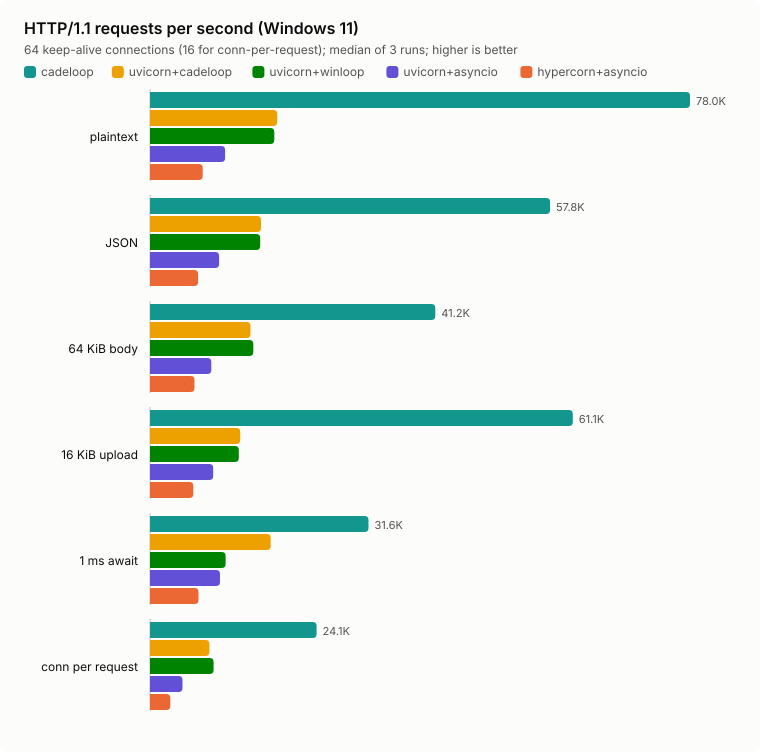
</picture>

<!-- table:bench-win-table-http -->
<picture>
  <source media="(prefers-color-scheme: dark)" srcset="https://raw.githubusercontent.com/cadezawacki/cadeloop/main/docs/assets/bench-win-table-http-dark.svg">
  
</picture>
<!-- /table -->

uvicorn ran its h11 parser (httptools was not installed on this machine)
and wsproto; hypercorn ran on asyncio. In `1 ms await` the app awaits
`asyncio.sleep(0.001)` before answering, `conn per request` opens a new
connection for every request, and `pipelined ×16` sends 16 requests per
round trip, which takes most of the kernel's per-request cost out and shows
the HTTP engine on its own.

<picture>
  <source media="(prefers-color-scheme: dark)" srcset="https://raw.githubusercontent.com/cadezawacki/cadeloop/main/docs/assets/bench-win-http-cpu-dark.svg">
  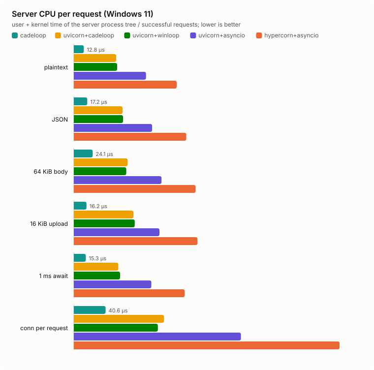
</picture>

<!-- table:bench-win-table-plaintext -->
<picture>
  <source media="(prefers-color-scheme: dark)" srcset="https://raw.githubusercontent.com/cadezawacki/cadeloop/main/docs/assets/bench-win-table-plaintext-dark.svg">
  
</picture>
<!-- /table -->

Most of cadeloop's 12.8 µs per request is the Windows kernel: 1.6 µs is
user time (parsing, the call into your app, encoding the response), and the
rest is the socket receive and send. Pipelined, where one receive carries
16 requests, the same engine served 553 K requests per second at 1.8 µs
each.

#### Memory

<picture>
  <source media="(prefers-color-scheme: dark)" srcset="https://raw.githubusercontent.com/cadezawacki/cadeloop/main/docs/assets/bench-win-idle-mem-dark.svg">
  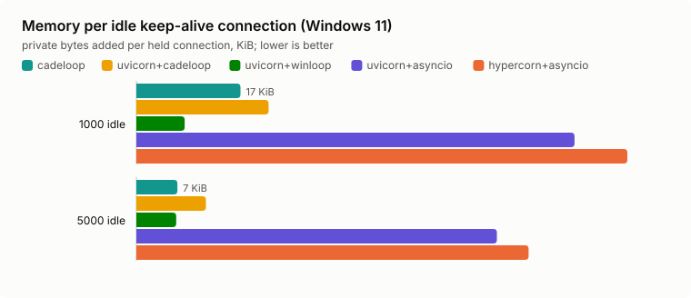
</picture>

<!-- table:bench-win-table-idle -->
<picture>
  <source media="(prefers-color-scheme: dark)" srcset="https://raw.githubusercontent.com/cadezawacki/cadeloop/main/docs/assets/bench-win-table-idle-dark.svg">
  
</picture>
<!-- /table -->

Each connection made one request and was then held open. Under load,
cadeloop peaked between 33 and 42 MiB of private memory across the HTTP
workloads. uvicorn on asyncio ranged from 29 to 40 MiB, hypercorn from 28 to
50 MiB (its peak was connection churn), uvicorn on cadeloop from 37 to
45 MiB, and uvicorn on winloop held 61 MiB from the start, with 12 threads.

#### WebSocket

<picture>
  <source media="(prefers-color-scheme: dark)" srcset="https://raw.githubusercontent.com/cadezawacki/cadeloop/main/docs/assets/bench-win-ws-dark.svg">
  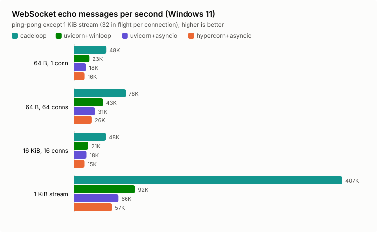
</picture>

<!-- table:bench-win-table-ws -->
<picture>
  <source media="(prefers-color-scheme: dark)" srcset="https://raw.githubusercontent.com/cadezawacki/cadeloop/main/docs/assets/bench-win-table-ws-dark.svg">
  
</picture>
<!-- /table -->

#### TLS

<!-- table:bench-win-table-tls -->
<picture>
  <source media="(prefers-color-scheme: dark)" srcset="https://raw.githubusercontent.com/cadezawacki/cadeloop/main/docs/assets/bench-win-table-tls-dark.svg">
  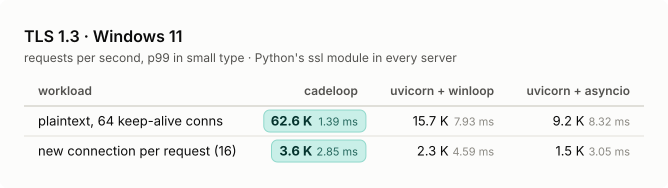
</picture>
<!-- /table -->

Every server used Python's `ssl` module. `new connection per request`
includes the full TLS 1.3 handshake.

#### Timers and wake-ups

<picture>
  <source media="(prefers-color-scheme: dark)" srcset="https://raw.githubusercontent.com/cadezawacki/cadeloop/main/docs/assets/bench-win-timers-dark.svg">
  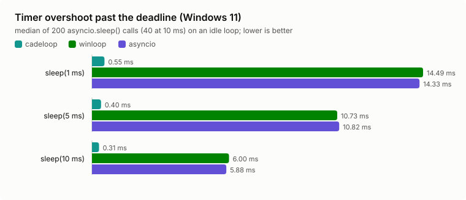
</picture>

<!-- table:bench-win-table-timers -->
<picture>
  <source media="(prefers-color-scheme: dark)" srcset="https://raw.githubusercontent.com/cadezawacki/cadeloop/main/docs/assets/bench-win-table-timers-dark.svg">
  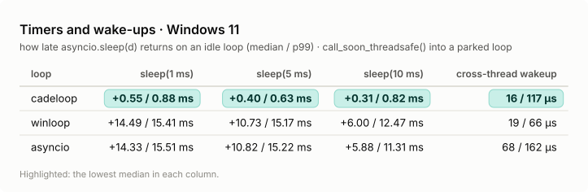
</picture>
<!-- /table -->

A Windows wait with a millisecond timeout ends on the next clock interrupt,
which comes every 15.6 ms by default. A loop that waits that way turns a
1 ms sleep into about 15 ms, which is also why `1 ms await` is the HTTP
workload where asyncio and winloop fall furthest behind. cadeloop ends a
wait that is bound by a timer on a high-resolution timer instead
([how](docs/learn/3-inside-cadeloop.md#timers-on-windows)); the
remaining half millisecond is the platform's own floor, and CPython 3.11's
`time.sleep(0.001)` overshoots by the same amount on this machine. A busy
loop seldom waits long enough for this to show; it matters most for lightly
loaded services and for code that sleeps on purpose.

#### TCP echo: the loop alone

<picture>
  <source media="(prefers-color-scheme: dark)" srcset="https://raw.githubusercontent.com/cadezawacki/cadeloop/main/docs/assets/bench-win-echo-dark.svg">
  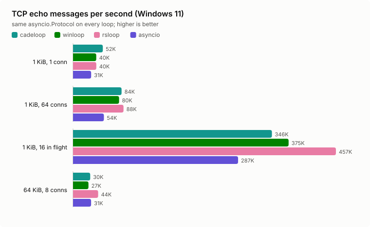
</picture>

<!-- table:bench-win-table-echo -->
<picture>
  <source media="(prefers-color-scheme: dark)" srcset="https://raw.githubusercontent.com/cadezawacki/cadeloop/main/docs/assets/bench-win-table-echo-dark.svg">
  
</picture>
<!-- /table -->

The same `asyncio.Protocol` echo server ran on every loop. rsloop does its
socket I/O on worker threads: it used 1.5 to 2 cores (26 threads) where the
others used one, and more CPU per message than cadeloop (4.4 against 2.9 µs
with 16 messages in flight). With one connection, cadeloop spins for up to
20 µs before it sleeps, which is why it answered fastest there.

#### Overload and recovery

<picture>
  <source media="(prefers-color-scheme: dark)" srcset="https://raw.githubusercontent.com/cadezawacki/cadeloop/main/docs/assets/bench-win-overload-dark.svg">
  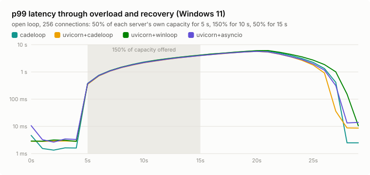
</picture>

Each server was offered 50% of its own measured capacity, then 150% for
10 seconds, then 50% again, from 256 connections at a fixed rate (open
loop), with latency measured from when each request was due so the backlog
shows. Every server kept serving at 92 to 95% of its measured capacity
through the overload, without errors, and was back to normal 12 to 14 seconds
after the overload ended. cadeloop's capacity
here was 77.9 K requests per second, against 18.4 K for uvicorn on cadeloop,
18.1 K on winloop and 10.9 K on asyncio.

#### Scheduling microbenchmarks

<picture>
  <source media="(prefers-color-scheme: dark)" srcset="https://raw.githubusercontent.com/cadezawacki/cadeloop/main/docs/assets/bench-win-sched-dark.svg">
  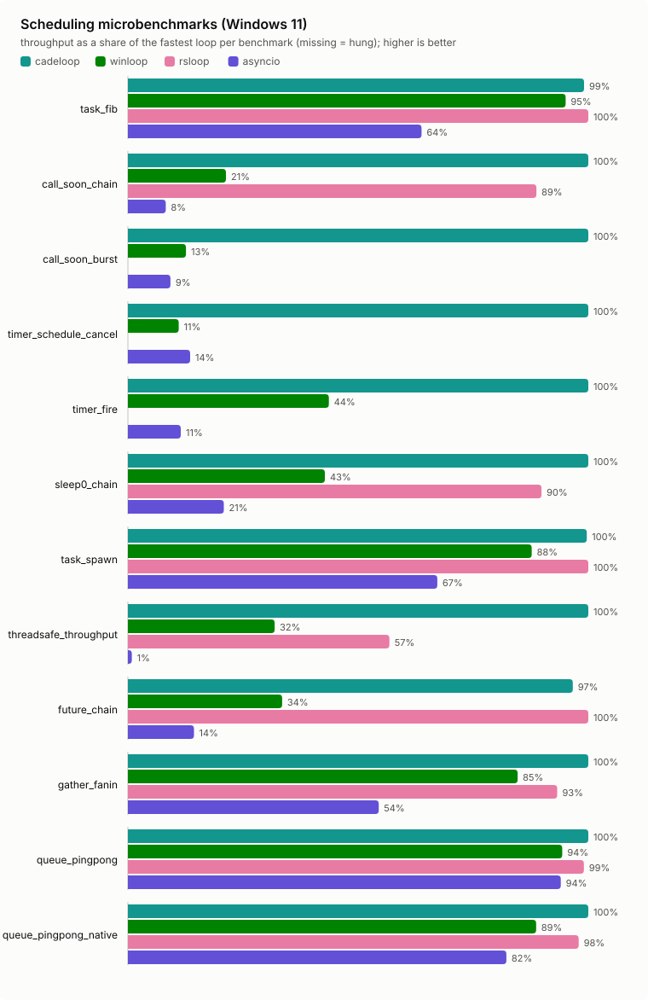
</picture>

<!-- table:bench-win-table-sched -->
<picture>
  <source media="(prefers-color-scheme: dark)" srcset="https://raw.githubusercontent.com/cadezawacki/cadeloop/main/docs/assets/bench-win-table-sched-dark.svg">
  
</picture>
<!-- /table -->

Each benchmark times one kind of loop operation in isolation, in a fresh
process per run. rsloop 0.1.30 never finished three of them
(`call_soon_burst`, `timer_schedule_cancel` and `timer_fire`) and was
stopped after 12 s.

### Linux (epoll)

Measured in November 2026 on a cloud VM with 4 vCPUs (Intel Xeon @ 2.10 GHz,
16 GB), Linux 6.18, CPython 3.11.18, cadeloop revision `2e2edee`; the raw
data is in [`bench/baselines/linux-2026-11`](bench/baselines/linux-2026-11/).
It is the same suite, load generator and app as on Windows, with the
contenders common on Linux: uvicorn on uvloop with h11 and wsproto (set up as
on Windows), `uvicorn[standard]` (httptools and websockets on uvloop, the
usual production setup), and granian. The load generator shared the VM,
limited to two threads so the server kept the other two cores.

Each number is the median of nine runs, spread over a session of under four
hours with the order of servers rotated: 1,818 runs, none with a failed
request. To measure the session's own noise, the same cadeloop build ran
through every workload twice, under two names. The two copies' medians
differed by 1.4% on the typical workload and by 5.5% on the worst, and their
intervals overlapped on all 28. A difference between two servers smaller
than that is not one these runs can show; the places in the tables are
shared accordingly.

#### HTTP

<picture>
  <source media="(prefers-color-scheme: dark)" srcset="https://raw.githubusercontent.com/cadezawacki/cadeloop/main/docs/assets/bench-linux-http-dark.svg">
  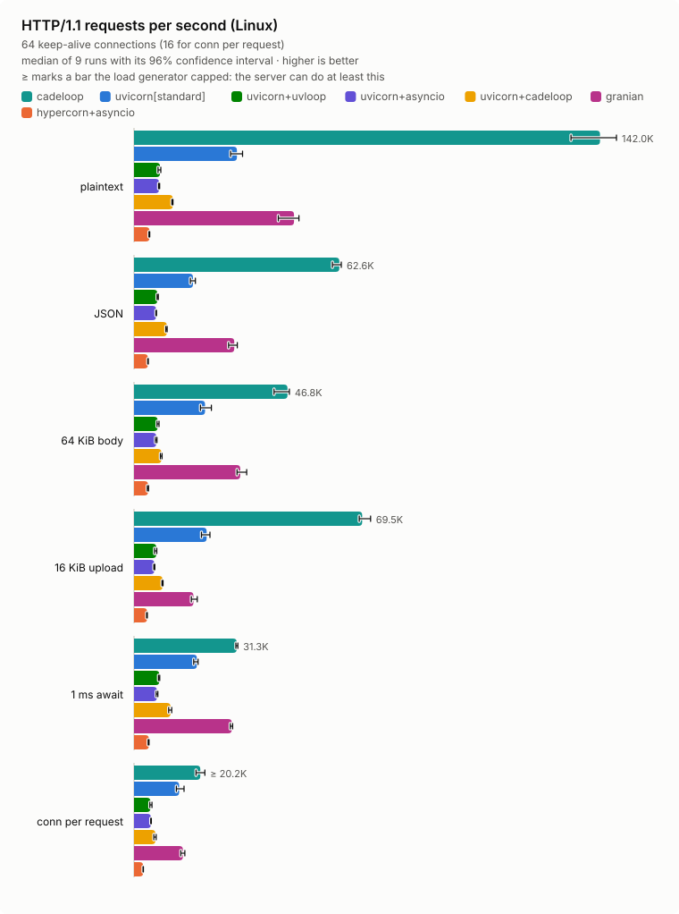
</picture>

<!-- table:bench-linux-table-http -->
<picture>
  <source media="(prefers-color-scheme: dark)" srcset="https://raw.githubusercontent.com/cadezawacki/cadeloop/main/docs/assets/bench-linux-table-http-dark.svg">
  
</picture>
<!-- /table -->

`cadeloop.serve()` led every workload, each time by more than the runs'
spread. On plaintext it handled 142 K requests per second: 4.5 times
`uvicorn[standard]` and 2.9 times granian, at 6.9 µs of CPU per request
against 31.5 and 31.3 µs. granian, which also does its HTTP work in Rust,
came closest where the handler or the response dominates: 5% behind with a
1 ms await in the handler (29.8 K against 31.3 K, a gap the intervals still
separate) and about 30% behind on 64 KiB responses and 1 MiB streams. With
one connection, where each request waits for the previous answer, cadeloop
answered in 31 µs at the median. With a new connection per request it kept
the load generator at its limit, so its 20.2 K is a floor.

Keeping uvicorn and its h11 parser fixed and changing only the loop,
cadeloop's loop made uvicorn 49% faster than on uvloop (11.8 K against 7.9 K
requests per second) and 55% faster than on asyncio (7.6 K). Under h11,
uvloop and asyncio themselves were not told apart.

<picture>
  <source media="(prefers-color-scheme: dark)" srcset="https://raw.githubusercontent.com/cadezawacki/cadeloop/main/docs/assets/bench-linux-http-cpu-dark.svg">
  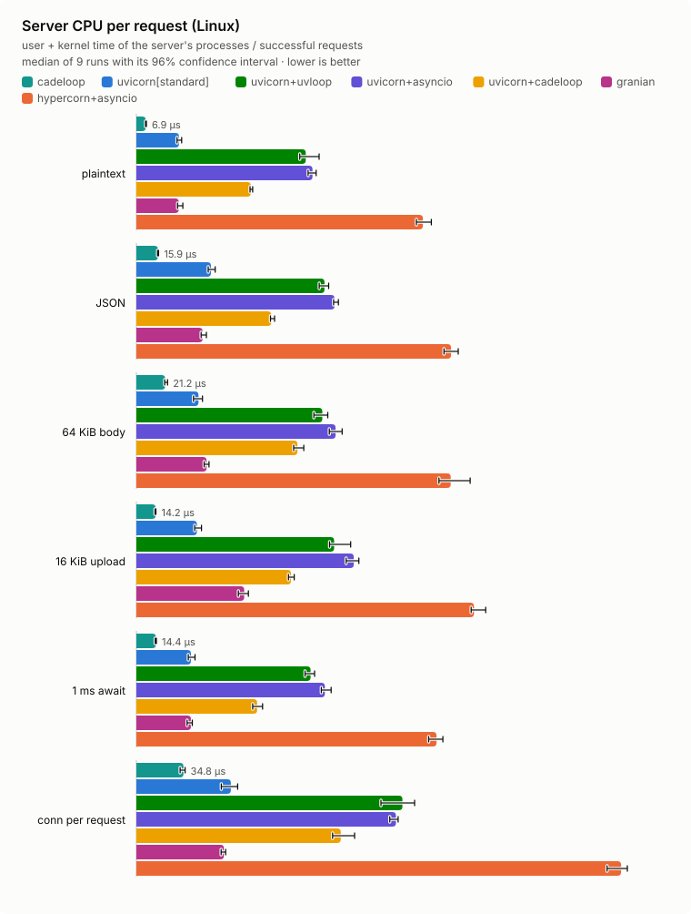
</picture>

<!-- table:bench-linux-table-plaintext -->
<picture>
  <source media="(prefers-color-scheme: dark)" srcset="https://raw.githubusercontent.com/cadezawacki/cadeloop/main/docs/assets/bench-linux-table-plaintext-dark.svg">
  
</picture>
<!-- /table -->

cadeloop ran as one process with one thread and kept one core busy, about
60% of it in the kernel's socket calls. granian ran two processes (a
supervisor and its worker) with six threads and used about 1.5 cores.
`pipelined ×16`, where one read carries 16 requests, shows the HTTP engine on
its own: 402 K requests per second at 2.5 µs of CPU each.

#### A FastAPI app

The workloads above are a bare ASGI app, which shows the servers and hides
what most deployments run on them. This is a small FastAPI app
([`bench/suite/fapp.py`](bench/suite/fapp.py)) on every server: a JSON route
whose response goes through a pydantic model, the same route as a plain
`def` (which FastAPI runs on a worker thread), and `FileResponse` at 64 KiB
and 1 MiB.

<picture>
  <source media="(prefers-color-scheme: dark)" srcset="https://raw.githubusercontent.com/cadezawacki/cadeloop/main/docs/assets/bench-linux-app-dark.svg">
  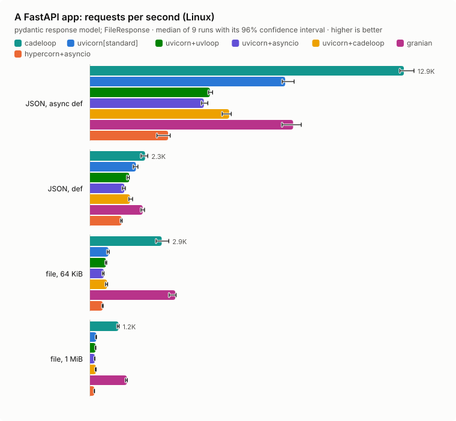
</picture>

<!-- table:bench-linux-table-app -->
<picture>
  <source media="(prefers-color-scheme: dark)" srcset="https://raw.githubusercontent.com/cadezawacki/cadeloop/main/docs/assets/bench-linux-table-app-dark.svg">
  
</picture>
<!-- /table -->

With FastAPI's routing and pydantic's validation in every request, the
server is a smaller share of the work and the gaps close. cadeloop served the
JSON route at 12.9 K requests per second, 1.5 times granian and 1.6 times
`uvicorn[standard]` (8.3 K and 8.0 K, which the runs did not tell apart).
On the `def` route every server waits on the same pool of 40 threads, and
cadeloop and granian tied at about 2.2 K.

Files are where granian led: 1.51 K requests per second against cadeloop's
1.17 K at 1 MiB, and 3.50 K against 2.94 K at 64 KiB, where the two
intervals only just separate. Both servers implement the ASGI path-send
extension, so Starlette hands them the path instead of reading the file
itself. uvicorn and hypercorn do not, read the file through worker threads,
and served a quarter to a fifth as many.

#### With the access log on

<!-- table:bench-linux-table-log -->
<picture>
  <source media="(prefers-color-scheme: dark)" srcset="https://raw.githubusercontent.com/cadezawacki/cadeloop/main/docs/assets/bench-linux-table-log-dark.svg">
  
</picture>
<!-- /table -->

An access log is on in nearly every deployment and off in nearly every
benchmark. With cadeloop's native log (`access_log_file`) writing a line per
request to a file, `serve()` kept 90% of its plaintext throughput: 128 K
requests per second. Sent through Python's `logging` instead
(`access_log=True`), the same server managed 25.9 K, a fifth as many; that
cost is what the native log is for. The other servers' own access logs,
each written the way that server writes it by default, took
`uvicorn[standard]` from 31.4 K to 13.3 K and granian from 48.8 K to 14.3 K.

#### Memory

<picture>
  <source media="(prefers-color-scheme: dark)" srcset="https://raw.githubusercontent.com/cadezawacki/cadeloop/main/docs/assets/bench-linux-idle-mem-dark.svg">
  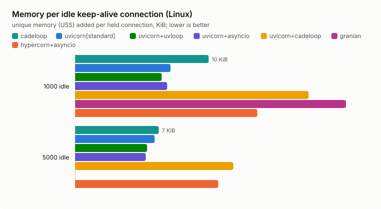
</picture>

<!-- table:bench-linux-table-idle -->
<picture>
  <source media="(prefers-color-scheme: dark)" srcset="https://raw.githubusercontent.com/cadezawacki/cadeloop/main/docs/assets/bench-linux-table-idle-dark.svg">
  
</picture>
<!-- /table -->

Memory on Linux is unique memory (USS): pages that belong to the server's
processes alone. At rest, every server used 20 to 28 MiB. Holding 5,000 idle
connections, uvicorn on asyncio and on uvloop used the least per connection
(5.5 and 5.6 KiB), `uvicorn[standard]` 6.2 KiB and cadeloop 6.5 KiB. Once the
connections closed, cadeloop handed back nearly three quarters of its growth
(it went from 62 MiB to 34 MiB), while uvicorn on asyncio and hypercorn kept
all of theirs. With its default settings, granian accepted 648 of the
5,000 connections and stopped there: 4,096 more waited unaccepted in the
kernel's queue and the last 256 timed out while connecting. So it has no
comparable figure at 5,000; at 1,000 connections it used 21.2 KiB each.
These are single measurements, not medians of nine.

#### WebSocket

<picture>
  <source media="(prefers-color-scheme: dark)" srcset="https://raw.githubusercontent.com/cadezawacki/cadeloop/main/docs/assets/bench-linux-ws-dark.svg">
  
</picture>

<!-- table:bench-linux-table-ws -->
<picture>
  <source media="(prefers-color-scheme: dark)" srcset="https://raw.githubusercontent.com/cadezawacki/cadeloop/main/docs/assets/bench-linux-table-ws-dark.svg">
  
</picture>
<!-- /table -->

cadeloop led four of the five WebSocket workloads outright: 2.1 times
`uvicorn[standard]` with one connection (29.2 K against 14.2 K messages per
second), 2.6 times granian with 64 connections (146 K against 55.6 K), 2.2
times granian at 16 KiB, and 8.9 times `uvicorn[standard]` when each
connection kept 32 messages in flight (456 K against 51.5 K). With 256 KiB
messages, where moving the payload is most of the work, cadeloop and granian
were not told apart (5.3 K and 5.9 K, with overlapping intervals).

#### TLS

<!-- table:bench-linux-table-tls -->
<picture>
  <source media="(prefers-color-scheme: dark)" srcset="https://raw.githubusercontent.com/cadezawacki/cadeloop/main/docs/assets/bench-linux-table-tls-dark.svg">
  
</picture>
<!-- /table -->

granian handles TLS in Rust; every other server here uses Python's `ssl`
module. Over keep-alive connections, cadeloop served 78.9 K requests per
second against granian's 51.2 K.

With a new connection and a full TLS 1.3 handshake for every request, the
answer depends on the certificate. Under an RSA 2048 key, the handshake's
signature is most of a request's cost on every server (0.7 to 1.2 ms of
CPU), and cadeloop led narrowly: 1.33 K requests per second against
granian's 1.20 K. Under an ECDSA P-256 key the signature is cheap, what each
server does around the handshake shows instead, and granian led clearly:
4.26 K against cadeloop's 2.58 K, at 0.22 ms of CPU per request against
0.39 ms.

#### TLS on the loop's own connections

The servers above terminate TLS inside their HTTP engines. This is TLS on
the loop's own transports: the echo protocol from the next section behind
`create_server(ssl=...)`, which is what a database driver's or an HTTP
client's TLS connections ride on. cadeloop appears twice: with the standard
library's TLS state machine on its transports (the default), and with its
own port of it ([`Loop(native_tls=True)`](#native-tls-for-your-own-connections)).
rloop is missing because its `create_server()` does not take `ssl=`.

<picture>
  <source media="(prefers-color-scheme: dark)" srcset="https://raw.githubusercontent.com/cadezawacki/cadeloop/main/docs/assets/bench-linux-tlsecho-dark.svg">
  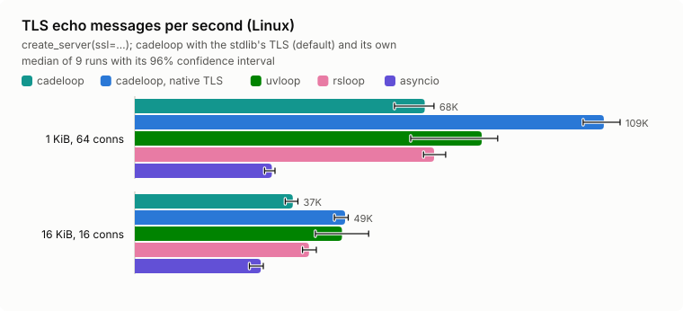
</picture>

<!-- table:bench-linux-table-tlsecho -->
<picture>
  <source media="(prefers-color-scheme: dark)" srcset="https://raw.githubusercontent.com/cadezawacki/cadeloop/main/docs/assets/bench-linux-table-tlsecho-dark.svg">
  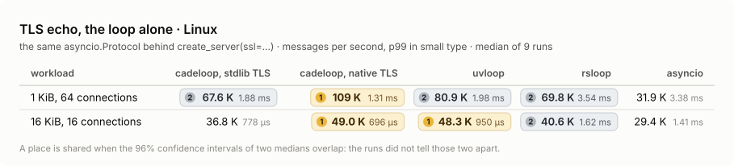
</picture>
<!-- /table -->

With 1 KiB messages, cadeloop's native TLS led at 109 K messages per second,
clear of every other loop. cadeloop's default, uvloop and rsloop (68 K, 81 K
and 70 K) were not told apart, mostly because uvloop's interval is wide
(64 K to 85 K), and asyncio trailed at 32 K. With 16 KiB messages, native TLS and
uvloop shared first place (49.0 K and 48.3 K), ahead of rsloop (40.6 K) and
cadeloop's default (36.8 K). The default path is level with the other
compiled loops on small messages and behind them on large ones; the opt-in
native path is what closes that gap.

#### Timers and wake-ups

<!-- table:bench-linux-table-timers -->
<picture>
  <source media="(prefers-color-scheme: dark)" srcset="https://raw.githubusercontent.com/cadezawacki/cadeloop/main/docs/assets/bench-linux-table-timers-dark.svg">
  
</picture>
<!-- /table -->

Linux wakes a sleeping thread on a fine-grained timer, so the Windows problem
above doesn't arise: on every loop, a 1 ms sleep overshot by 0.11 to 0.18 ms
at the median. Longer sleeps overshot a little more, cadeloop's the most:
0.33 ms at both 5 ms and 10 ms, against 0.15 to 0.26 ms on the other loops.
A `call_soon_threadsafe()` from another thread reached a sleeping loop in
100 to 108 µs at the median on rloop, cadeloop and rsloop, which the runs did
not separate, in 119 µs on uvloop and in 144 µs on asyncio.

#### TCP echo: the loop alone

<picture>
  <source media="(prefers-color-scheme: dark)" srcset="https://raw.githubusercontent.com/cadezawacki/cadeloop/main/docs/assets/bench-linux-echo-dark.svg">
  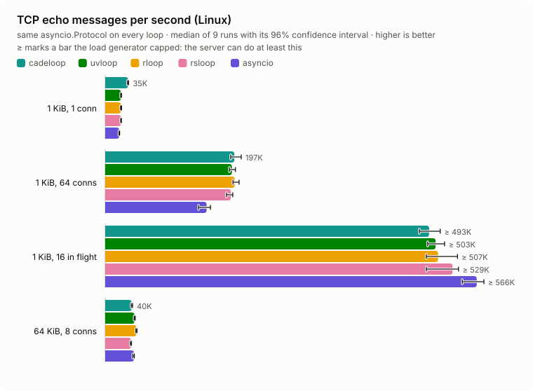
</picture>

<!-- table:bench-linux-table-echo -->
<picture>
  <source media="(prefers-color-scheme: dark)" srcset="https://raw.githubusercontent.com/cadezawacki/cadeloop/main/docs/assets/bench-linux-table-echo-dark.svg">
  
</picture>
<!-- /table -->

The same `asyncio.Protocol` echo server ran on each loop, so this compares
the loops alone. With one connection, cadeloop answered fastest (34.9 K
messages per second and 25 µs at the median, against about 24 K for uvloop,
rloop and rsloop), using more CPU per message than they do because it keeps
spinning while messages arrive back to back. With 64 connections, cadeloop,
rloop, uvloop and rsloop were within about 3% of each other (191 K to 197 K) and
the runs did not separate them; asyncio was at 154 K. With 16 messages in
flight, every loop kept the load generator at its limit, so that row says
only that each of them can do at least 490 K messages per second.
With 64 KiB messages cadeloop was behind: 40.3 K messages per second against
rloop's 47.5 K, uvloop's 44.6 K and asyncio's 43.8 K, and level with rsloop.
Large messages remain the weakest spot of cadeloop's Linux backend.

#### Overload and recovery

<picture>
  <source media="(prefers-color-scheme: dark)" srcset="https://raw.githubusercontent.com/cadezawacki/cadeloop/main/docs/assets/bench-linux-overload-dark.svg">
  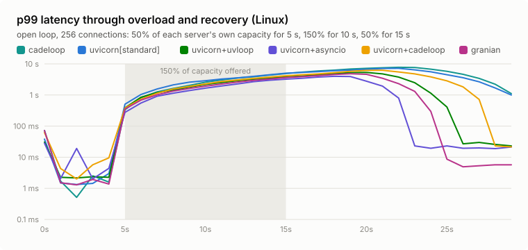
</picture>

The same test as on Windows: 50% of each server's own measured capacity, then
150% for 10 seconds, then 50% again, from 256 connections at a fixed rate.
It is one run per server, not nine. No server failed a request or stopped
serving. How quickly each one recovered came down to how fast it worked
through its backlog compared with the capacity measured beforehand with 64
connections. uvicorn on asyncio served 5% above that capacity while it had a
backlog and was back to normal 8 seconds after the overload ended; granian
served at its capacity (50.6 K requests per second) and took 10 seconds;
uvicorn on uvloop and on cadeloop's loop took 11 and 13. cadeloop and
`uvicorn[standard]` served 11% and 9% below their capacity (122 K against
137 K for cadeloop) and were still working through their backlogs when the
30 seconds ended.

#### Scheduling microbenchmarks

<picture>
  <source media="(prefers-color-scheme: dark)" srcset="https://raw.githubusercontent.com/cadezawacki/cadeloop/main/docs/assets/bench-linux-sched-dark.svg">
  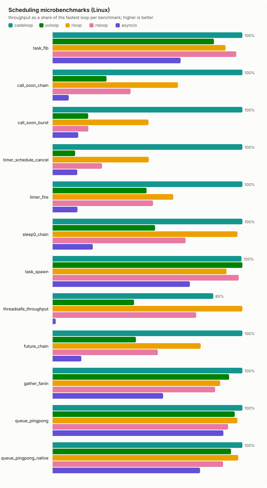
</picture>

<!-- table:bench-linux-table-sched -->
<picture>
  <source media="(prefers-color-scheme: dark)" srcset="https://raw.githubusercontent.com/cadezawacki/cadeloop/main/docs/assets/bench-linux-table-sched-dark.svg">
  
</picture>
<!-- /table -->

cadeloop was first or shared first on 7 of the 12 benchmarks: alone on four
(`call_soon_burst`, `timer_schedule_cancel`, `timer_fire` and `future_chain`)
and level with rloop on three (`call_soon_chain`, `sleep0_chain` and
`threadsafe_throughput`). On the other five, `task_fib` among them, where one
call to `fib(21)` grows a tree of 35,421 tasks, the compiled loops were
within the runs' spread of each other and nothing is marked. These
benchmarks vary more from one run to the next than the load tests do, so
each loop's nine runs were taken in turn with the other loops' instead of
one loop at a time.

---

## Event loop mode: reference

Everything in this section is about cadeloop as an asyncio event loop. It
applies whether you run plain asyncio code, aiohttp, or uvicorn on top. For
the HTTP server, see [server mode](#server-mode-reference).

### Turning it on

There are five ways in, depending on how much of the process you want
cadeloop to take over.

**`cadeloop.install()`** makes cadeloop the event loop for the whole
process: every later `asyncio.run()`, `asyncio.new_event_loop()` or
`asyncio.Runner()` gets a cadeloop loop. This is how uvloop and winloop are
usually used too. Call it once, at startup, before anything creates a loop;
a library that created its loop earlier keeps that one.

```python
import asyncio
import cadeloop

cadeloop.install()
asyncio.run(main())
```

**`cadeloop.run(coro, *, debug=None)`** works like `asyncio.run()` but always
uses a new cadeloop loop, without changing anything for the rest of the
process. Good for libraries, tests, and processes that share their main
thread with other code.

```python
result = cadeloop.run(main())
```

**`asyncio.Runner` with a loop factory** gives you a tuned loop with the
standard runner:

```python
with asyncio.Runner(loop_factory=lambda: cadeloop.Loop(spin_us=200)) as runner:
    runner.run(main())
```

**`cadeloop.new_event_loop()`** returns a loop object you manage yourself:

```python
loop = cadeloop.new_event_loop()
try:
    loop.run_until_complete(main())
finally:
    loop.close()
```

**`cadeloop.EventLoopPolicy()`** is for frameworks that take an event loop
policy:

```python
asyncio.set_event_loop_policy(cadeloop.EventLoopPolicy())
```

The policy extends the platform's default policy, so subprocess support
keeps working after the swap on Linux.

### `Loop()` arguments

`cadeloop.Loop(**kwargs)` creates a loop with non-default settings. Every
argument is keyword-only. These arguments exist only in loop mode; the
server has its own settings, some with different names or defaults (see
[settings in both modes](#settings-in-both-modes)).

| argument | default | what it does |
|---|---|---|
| `backend` | `None` | The I/O backend: `"auto"`, `"iocp"`, `"rio"` or `"epoll"`. `None` reads the `CADELOOP_BACKEND` environment variable, else uses `"auto"`, which picks IOCP on Windows and epoll on Linux. `"rio"` is experimental and warns: it has not worked on any Windows machine tested, for reasons inside Windows, and `"auto"` never selects it. |
| `spin_us` | `20` | How many microseconds the loop keeps checking for new work before it sleeps. More spinning lowers wake-up latency and costs CPU. `0` turns it off. |
| `adaptive_spin` | `True` | Spin only while spins are catching work, and skip it while they aren't ([how it decides](docs/learn/3-inside-cadeloop.md#spin-then-park)). `False` spins before every sleep. |
| `high_water` | `65536` | Bytes a transport may queue before it asks the protocol to pause writing (`pause_writing()`, `drain()` waits). |
| `low_water` | `16384` | Writing resumes once the queue falls below this. Must not exceed `high_water`. |
| `accept_pool` | `64` | Accepts kept ready per listening socket. Raise it if a burst of new connections makes `stats()["accept_starved"]` climb. |
| `dns_cache` | `False` | Cache `getaddrinfo()` answers. Off by default, as in asyncio. |
| `dns_cache_ttl` | `5.0` | How long a cached DNS answer is kept, in seconds. The record's own TTL is not used. |
| `resolver_threads` | `0` | `0`: name lookups run in the default executor, as in asyncio. `N`: on up to `N` threads of their own, and coroutines asking for the same name at once share one lookup. See [name lookups](#name-lookups). |
| `tfo` | `False` | TCP Fast Open on listening sockets. |
| `native_tls` | `None` | Use cadeloop's own TLS layer for `create_connection(ssl=...)`, `create_server(ssl=...)` and `start_tls()` instead of the standard library's. `None` reads `CADELOOP_NATIVE_TLS` (`1` turns it on), else off. See [native TLS for your own connections](#native-tls-for-your-own-connections). |
| `loopback_fast_path` | `True` | Windows `SIO_LOOPBACK_FAST_PATH` on loopback sockets. Only matters for traffic within one machine. |
| `rio_cq_size`, `rio_rq_recv`, `rio_rq_send` | `65536`, `32`, `32` | Queue sizes for the experimental RIO backend on Windows. Ignored elsewhere. |

```python
loop = cadeloop.Loop(
    spin_us=200,          # lower latency, more CPU
    accept_pool=256,      # many new connections at once
    high_water=1 << 20,   # let transports queue 1 MiB before backpressure
    low_water=1 << 18,
    dns_cache=True,
)
```

### Native TLS for your own connections

TLS on connections your code opens -- an HTTPS request through aiohttp, a
`wss://` client, a database driver over TLS, `start_tls()`, or a
`create_server(ssl=...)` you run yourself -- normally goes through asyncio's
own `sslproto` module, on any event loop. It is correct, and it is the
slowest part of a TLS connection: a dozen Python calls around every message,
and a 256 KiB buffer allocated for every connection.

`native_tls=True` replaces it with a Rust port of the same code. OpenSSL
still does the TLS, through the same `ssl.SSLContext` you pass in, so
certificates, verification, ciphers and protocol versions behave exactly as
before. What changes is the cost around it:

| one worker, 64 connections, loopback, Linux | asyncio's `sslproto` on cadeloop | `native_tls=True` | uvloop |
|---|---|---|---|
| TLS echo, 1 KiB messages | 76k msg/s | 111k msg/s | 83k msg/s |
| TLS echo, 16 KiB messages | 30k msg/s | 37k msg/s | 46k msg/s |
| memory, 2,000 open TLS connections | 540 MiB | 83 MiB | 57 MiB |

```python
loop = cadeloop.Loop(native_tls=True)               # loop mode
cadeloop.serve(app, native_tls=True)                # the server's loop
```

or, with no code change, `CADELOOP_NATIVE_TLS=1` in the environment.

It is off by default in this release. It passes CPython's own `sslproto`
and TLS test suites and is checked against asyncio, callback by callback,
on generated scenarios; aiohttp, `websockets` and uvicorn are tested on it.
What is still missing is time in production, so the standard library's path
stays the default until it has had some. (`cadeloop.serve(ssl=...)` is not
affected either way: the server terminates TLS in its own engine.)

One behavior is deliberately different: a `BufferedProtocol` whose
`get_buffer()` returns a `bytearray` receives correct data. On CPython
3.11 to 3.13, asyncio hands such a protocol stale bytes over TLS.

Apart from these, a `Loop` is an ordinary asyncio event loop. It supports
`run_forever`, `run_until_complete`, `call_soon`, `call_later`, `call_at`,
`call_soon_threadsafe`, `create_task`, `create_future`, `run_in_executor`,
`add_reader` and `add_writer`, the `sock_*` methods, `add_signal_handler`,
`create_server`, `create_connection`, `create_datagram_endpoint`,
`create_unix_server`, `subprocess_exec`, `sendfile`, `start_tls`,
`set_exception_handler`, `set_task_factory` and `close`. Debug mode
(`PYTHONASYNCIODEBUG=1` or `python -X dev`) and `loop.slow_callback_duration`
behave as in asyncio.

### `loop.stats()`

`loop.stats()` returns a dict of counters describing what the loop has done.
It is cheap enough to call often. A server started with `--stats-endpoint`
serves the same dict as JSON.

| key | meaning |
|---|---|
| `backend` | The backend in use: `"iocp"`, `"rio"` or `"epoll-dev"`. |
| `ticks` | Trips around the loop so far. |
| `polls` | Times the loop asked the OS for I/O events. |
| `polls_elided` | Polls skipped because no I/O was in flight, so the OS had nothing to report. Pure scheduling work, such as tasks passing messages through a queue, never makes the system call. |
| `completions` | I/O operations that finished. |
| `callbacks_dispatched` | Callbacks run. |
| `timers_fired` | Timers that went off. |
| `xthread_items` | Callbacks and timers that other threads handed over while the loop was asleep. |
| `spins` | Waits that began with a spin. |
| `spin_hits` | Spins that caught new work, saving a sleep and a wake-up. Work that was already waiting when the spin began doesn't count. |
| `precise_parks` | Waits ended by a high-resolution timer (Windows). |
| `ready_len`, `timers_len` | Callbacks waiting to run, and timers scheduled, right now. |
| `connections`, `listeners` | Open connections and listening sockets. |
| `connections_accepted` | Connections accepted so far. |
| `bytes_received`, `bytes_sent` | Totals so far. |
| `sends_posted` | Send operations made. Compare with `bytes_sent` to see how much writes are being batched. |
| `buffers_in_use` | Receive buffers currently holding data. |
| `buffer_bytes_in_use`, `buffer_bytes_held` | Memory in those buffers, and memory the buffer pool holds in total, used or free. Free memory beyond a small reserve goes back to the OS after a burst. |
| `accept_starved` | Times a listener ran out of ready accepts. If it keeps climbing, raise `accept_pool`. |
| `accept_ops` | Accept operations waiting in the kernel. |
| `pipeline_pauses` | Times the HTTP server stopped reading a connection because too many pipelined requests were queued. |
| `ops_by_target` | Kernel operations in flight, by kind (`recv`, `send`, `accept`, `connect`, `dgram`, `pipe`). A stuck server shows up here first. |
| `foreign_completions` | Windows: completion packets that did not belong to a live operation of this loop, for example another process's I/O on a socket handle shared with it. They are dropped and counted. Always 0 on Linux. |
| `dns_lookups`, `dns_coalesced`, `dns_cache_hits` | Name lookups sent to the operating system's resolver, calls that joined a lookup of the same name already in flight (`resolver_threads`), and calls answered from the cache (`dns_cache`). |
| `stale_buffer_ids`, `unreaped_ops` | Leak checks. Both should always be 0. |

---

## Server mode: reference

Everything in this section is about cadeloop as an HTTP server: the
`cadeloop` command, `cadeloop.serve()` and `cadeloop.Config`. They take the
same settings.

### Three ways to start it

```bash
cadeloop main:app --port 8000 --workers 4                    # the command
```

```python
cadeloop.serve("main:app", "0.0.0.0", 8000, workers=4)       # from Python
```

```python
cfg = cadeloop.Config(workers=4, latency_mode="throughput")  # settings as an object
cadeloop.serve("main:app", "0.0.0.0", 8000, **vars(cfg))
```

`serve()` blocks until the server stops: on `SIGINT` or `SIGTERM`, or when
your code calls `loop.stop()`.

### `serve()` arguments

```python
cadeloop.serve(app, host="127.0.0.1", port=8000, *, workers=1, backend="auto",
               ssl=None, latency_mode="balanced", access_log=False,
               access_log_tap=None, **settings)
```

| argument | default | meaning |
|---|---|---|
| `app` | required | An ASGI 3 app, or a `"module:attribute"` string. Use the string with `workers > 1` (required on Windows). |
| `host` | `"127.0.0.1"` | Address to listen on. `"0.0.0.0"` accepts connections from other machines. |
| `port` | `8000` | Port to listen on. |
| `workers` | `1` | Worker processes. `0` means one per CPU this process may use (its affinity mask, so a container's CPU limit counts). |
| `ssl` | `None` | An `ssl.SSLContext` to serve HTTPS. Its ALPN protocols are set to `http/1.1`. |
| `**settings` | | Any of the [settings](#settings) below, by name. An unknown name raises `TypeError`, a bad value `ValueError`. |

`backend`, `latency_mode` and `access_log` are settings too; they are spelled
out in the signature because they are the ones most often changed.

### Settings

Every setting can be given to `serve()` by name, to `Config(...)`, as a
command-line flag (underscores become dashes, so `max_body` is `--max-body`),
or as an environment variable read by `Config.from_env()` (`CADELOOP_MAX_BODY`).
Values are checked when the server starts, before anything binds or runs.

#### Performance

| setting | default | meaning |
|---|---|---|
| `latency_mode` | `"balanced"` | A preset for the three settings below. `"throughput"`: never spin. `"balanced"`: spin up to 20 µs while spinning catches work. `"spin"`: spin 200 µs before every sleep and send responses at once. See [choosing a latency mode](#choosing-a-latency-mode). |
| `spin_us` | from `latency_mode` | Spin window in microseconds. Set it to override the preset. |
| `adaptive_spin` | from `latency_mode` | Spin only while spinning catches work. On unless `latency_mode="spin"`. |
| `immediate_flush` | from `latency_mode` | Send each response as soon as it is ready, instead of batching a connection's writes until the end of the loop's tick. On only for `"spin"`. |
| `backend` | `"auto"` | The I/O backend, as in loop mode. `"rio"` also needs `CADELOOP_ALLOW_EXPERIMENTAL_RIO=1`. |
| `eager_tasks` | `True` | Start each request's handler immediately, inside the tick that parsed the request. Turn off if a library expects tasks to start later. |
| `gc_mode` | `"freeze"` | `"freeze"` calls `gc.freeze()` after startup and again after `warmup` requests, so the garbage collector stops re-scanning objects that live for the whole run. `"refreeze"` also does it after any full collection that took over 10 ms. `"default"` leaves the collector alone; `"disable"` turns it off. See [garbage collection](#garbage-collection). |
| `warmup` | `1000` | With `gc_mode="freeze"`, the number of requests to serve before the second freeze. `0` freezes only at startup. |

#### Requests and connections

| setting | default | meaning |
|---|---|---|
| `max_body` | `16777216` | Largest request body in bytes; bigger ones get `413`. The server collects the whole body in memory and passes it to your app in one message, so this also bounds the memory one request can take. `None` removes the limit. |
| `max_header_bytes` | `65536` | Largest request head in bytes; bigger ones get `431`. |
| `max_headers` | `100` | Most header lines per request. |
| `max_url` | `8192` | Longest request target (path and query). |
| `request_line_timeout` | `5.0` | Seconds a client may take to send a complete request head. Stops clients that open connections and trickle bytes. `0` disables it. |
| `keepalive_idle` | `75.0` | Seconds an idle keep-alive connection stays open. `0` keeps it open until the client closes it. |
| `write_high_water`, `write_low_water` | `65536`, `16384` | Backpressure: when a connection's unsent output passes the high mark, `send()` waits until it drains below the low mark. |
| `accept_pool` | `64` | Accepts kept ready per listening socket. |
| `tfo` | `False` | TCP Fast Open on the listening socket. |
| `ws_compression` | `False` | Accept WebSocket clients' offers of `permessage-deflate` and compress messages of 1 KiB to 1 MiB. Costs CPU on the loop thread, saves bandwidth; see [WebSockets](#websockets). |

#### Workers and shutdown

| setting | default | meaning |
|---|---|---|
| `workers` | `0` in `Config`, `1` in `serve()` and the command | Worker processes; `0` means one per available CPU. |
| `grace` | `10.0` | Seconds a shutdown waits for requests in flight before closing them. Up to a quarter of it, at most 5 s, is kept for your lifespan's shutdown code. |
| `pin` | `False` | Pin each worker's loop thread to one CPU. It measured no gain on loopback and hurts on shared or virtual CPUs; worth trying on dedicated hardware with NIC queues aligned to the workers. |

#### Logging, monitoring and DNS

| setting | default | meaning |
|---|---|---|
| `access_log` | `False` | Log each request on the `cadeloop.access` logger, from a background thread that never blocks the loop. Nothing shows until logging is configured at INFO, for example with `logging.basicConfig(level=logging.INFO)`. Your handlers, formatters and filters apply; it is also the expensive way to log (see below). |
| `access_log_file` | `None` | Write the access log natively instead: a path to append to, or `-` for standard output. See [the native access log](#the-native-access-log). |
| `access_log_format` | `"text"` | The native log's format: `"text"` or `"json"`. |
| `access_log_tap` | `None` | A callable, or its `"module:callable"` name, handed the finished requests in batches. See [the native access log](#the-native-access-log). |
| `stats_endpoint` | `None` | A port on which to serve `loop.stats()` as JSON, on `127.0.0.1` only. In a multi-worker server, one worker answers, and the payload says which. |
| `dns_cache` | `True` | Cache `getaddrinfo()` answers for outgoing connections your app makes. On by default for servers, unlike loop mode. |
| `dns_cache_ttl` | `5.0` | Seconds a cached answer is kept. |
| `resolver_threads` | `16` | Threads that do nothing but name lookups, started as lookups need them. A lookup then never waits behind your app's blocking calls, and requests asking for the same name at once share one lookup. `0` runs lookups in the default executor, as loop mode does. See [name lookups](#name-lookups). |
| `native_tls` | `False` | Use cadeloop's own TLS layer for the TLS connections your app opens (`create_connection(ssl=...)`, `start_tls()`); see [native TLS for your own connections](#native-tls-for-your-own-connections). Does not change `ssl=` on the server itself. |

#### Windows only

| setting | default | meaning |
|---|---|---|
| `loopback_fast_path` | `True` | `SIO_LOOPBACK_FAST_PATH` on loopback sockets. |
| `rio_cq_size`, `rio_rq_recv`, `rio_rq_send` | `65536`, `32`, `32` | Queue sizes for the experimental RIO backend. |

### The native access log

`access_log=True` goes through Python's `logging`: a `LogRecord`, a format
and a handler call for every request, all of it needing the GIL. On the
plain-text benchmark that costs more than five times the request it logs
(136k requests/s with no log, 26k with it; one worker, Linux, loopback).

`access_log_file` writes the log from Rust instead. A finished request is
formatted straight into a buffer, and once per loop tick the buffer goes to
a writer thread that never touches the interpreter, so a slow disk or a full
pipe cannot stall the loop or your application. The same benchmark runs at
128k requests/s with it on.

```python
cadeloop.serve(app, access_log_file="access.log")                    # text
cadeloop.serve(app, access_log_file="-", access_log_format="json")   # stdout
```

```text
2026-11-27T15:38:01.123Z 127.0.0.1:41692 "GET /items?page=2" 200 0.42ms
```

```json
{"ts":"2026-11-27T15:38:01.123Z","client":"127.0.0.1:41692","method":"GET","target":"/items?page=2","status":200,"duration_ms":0.42}
```

What to know:

- Times are UTC. Bytes in the target that are not printable ASCII are
  written as `\xNN` (text) or `\u00NN` (JSON), so a request cannot forge a
  line.
- The file is opened for appending and each write is whole lines, so
  several workers can share one file. A file that a log rotator renames or
  removes is reopened under the same name within a second.
- Lines reach the writer once per tick and the file as fast as it takes
  them. If the writer falls more than 8 MiB behind, new records are dropped
  and counted, and the count is written into the log when it catches up.
  `loop.stats()` reports `access_log_records` and `access_log_dropped`.
- A process killed outright loses the lines of its last tick; a normal
  shutdown writes everything.
- It does not go through `logging`, so handlers and filters do not apply.
  `access_log=True` still does, and both can be on at once.

To get the records in Python without paying for a call per request, give
`access_log_tap` a callable. It is called on the loop thread, once per tick
that finished any request, with a list of `(client, method, target, status,
duration_ms)` tuples: `client` is the peer's `(host, port)` or `None`,
`target` is `bytes`. It works with or without a file.

```python
def tap(records):
    for client, method, target, status, duration_ms in records:
        latency.observe(duration_ms)
        if status >= 500:
            errors.inc()

cadeloop.serve(app, access_log_file="access.log", access_log_tap=tap)
```

Keep the tap short, or hand the list to a thread: it runs between requests.
An exception it raises goes to the loop's exception handler and the next
batch is delivered as usual. With `workers > 1` on Windows, name it as a
string (`"mymodule:tap"`), since spawned workers import it the way they
import the app.

### The `cadeloop` command

```bash
cadeloop APP [options]
python -m cadeloop APP [options]
```

| option | meaning |
|---|---|
| `APP` | The app as `module:attribute`, imported from the current directory. |
| `--app-dir DIR` | Import the app from `DIR` instead. |
| `--host HOST`, `--port`, `-p PORT` | Where to listen. Defaults: `127.0.0.1`, `8000`. |
| `--workers`, `-w N` | Worker processes. Default 1; `0` means one per CPU. |
| `--backend {auto,epoll}` | On Windows the choices are `auto`, `iocp` and `rio`. |
| `--latency-mode {throughput,balanced,spin}` | The performance preset. |
| `--SETTING VALUE` | Every other [setting](#settings), with dashes for underscores: `--max-body 1048576`, `--keepalive-idle 30`, `--gc-mode default`. |
| `--SETTING` / `--no-SETTING` | On/off settings: `--access-log`, `--no-eager-tasks`, `--no-adaptive-spin`. |
| `none` | `--spin-us`, `--max-body` and `--stats-endpoint` accept `none`: `--max-body none` removes the body limit. |

```bash
# one low-latency worker, no body limit, stats on port 9001
cadeloop main:app --latency-mode spin --max-body none --stats-endpoint 9001

# a worker per CPU, tuned for throughput, short keep-alive
cadeloop main:app -w 0 --latency-mode throughput --keepalive-idle 15
```

### Environment variables

| variable | read by | effect |
|---|---|---|
| `CADELOOP_<SETTING>` | `Config.from_env()` | Sets that setting: `CADELOOP_WORKERS=8`, `CADELOOP_MAX_BODY=none`, `CADELOOP_ACCESS_LOG=true`. On/off values accept `1/0`, `true/false`, `yes/no`, `on/off`. |
| `CADELOOP_BACKEND` | `Loop()` | The default backend when none is given. Useful for running a whole test suite against one backend. |
| `CADELOOP_ALLOW_EXPERIMENTAL_RIO` | `Config` | Required before `Config`, `serve()` or the command accept `backend="rio"`. |
| `PYTHONASYNCIODEBUG` | `Loop()` | asyncio debug mode, as with the standard loop. |

```python
cfg = cadeloop.Config.from_env()     # or Config.from_env(prefix="MYAPP_")
cadeloop.serve("main:app", "0.0.0.0", 8000, **vars(cfg))
```

### HTTPS

```python
import ssl

ctx = ssl.SSLContext(ssl.PROTOCOL_TLS_SERVER)
ctx.load_cert_chain("cert.pem", "key.pem")
cadeloop.serve("main:app", "0.0.0.0", 8443, ssl=ctx)
```

Encryption uses Python's `ssl` module, so any context you can build works.
The server speaks HTTP/1.1 only, so it sets the context's ALPN list to
`http/1.1`; otherwise a client could agree on HTTP/2 during the handshake
and then have every request rejected.

### Sending files

`FileResponse` and `StaticFiles` in Starlette and FastAPI are faster on
cadeloop without any change to your app. The server implements the ASGI
*Path Send* extension, so the framework hands it a file path and cadeloop
sends the file, where it would otherwise read the file itself, 64 KiB at a
time, with a hop to a worker thread for every piece.

| `FileResponse`, one worker, Linux, loopback | read by the framework | sent by cadeloop |
|---|---|---|
| 16 KiB file | 1,240 requests/s | 4,540 requests/s |
| 64 KiB file | 1,040 requests/s | 3,950 requests/s |
| 1 MiB file | 285 requests/s | 1,180 requests/s |
| 10 MiB file | 37 requests/s | 183 requests/s |

Files up to 256 KiB are read in one piece on the loop thread; larger ones
are read 1 MiB at a time on a small thread pool of their own, so a file
that is not in the page cache, or sits on a slow disk, does not stall other
requests. It works the same over HTTPS and on Windows. Range requests are
still answered by the framework.

Without a framework, send the message yourself after the response start:

```python
await send({"type": "http.response.start", "status": 200,
            "headers": [(b"content-length", str(os.path.getsize(path)).encode())]})
await send({"type": "http.response.pathsend", "path": path})
```

### WebSockets

WebSocket connections reach your app as `websocket` scopes, as in any ASGI
server; FastAPI's and Starlette's WebSocket routes work as they do
elsewhere. Without a framework:

```python
async def app(scope, receive, send):
    if scope["type"] == "websocket":
        await receive()                                   # websocket.connect
        await send({"type": "websocket.accept"})
        while True:
            message = await receive()
            if message["type"] == "websocket.disconnect":
                break
            await send({"type": "websocket.send", "text": message["text"]})
```

**Compression** is off unless you turn it on with `ws_compression=True`
(`--ws-compression`). The server then accepts a client's offer of
`permessage-deflate`, which browsers and most client libraries make by
default, and messages between 1 KiB and 1 MiB are sent compressed when
that makes them smaller. Shorter and longer ones, and data that does not
compress, are sent as they are.

| JSON text, echoed | extra server CPU per message | bytes on the wire, each way |
|---|---|---|
| 1 KiB | 2.5 µs | 175 instead of 937 |
| 8 KiB | 30 µs | 892 instead of 7,742 |
| 64 KiB | 265 µs | 7,114 instead of 64,280 |

That CPU is spent on the loop thread, which is why it is a choice: on a
fast network it buys nothing, and on a slow or metered one it buys a lot.
It is negotiated without "context takeover", so it adds no memory per
connection however many are open, and what a compressed message may
inflate to is bounded by the same limit as any other message. If your
payloads are already compressed (Arrow IPC with LZ4 or ZSTD, images,
archives), leave it off: they will not shrink, and the server would only
find that out by trying.

### Lifespan

The ASGI lifespan protocol is detected and run automatically, once per
worker: startup before the worker accepts connections, shutdown after its
last request. An app that doesn't support lifespan is served normally.
FastAPI's `lifespan=` and Starlette's `lifespan=` both use it. Without a
framework:

```python
async def app(scope, receive, send):
    if scope["type"] == "lifespan":
        while True:
            message = await receive()
            if message["type"] == "lifespan.startup":
                await pool.connect()
                await send({"type": "lifespan.startup.complete"})
            elif message["type"] == "lifespan.shutdown":
                await pool.close()
                await send({"type": "lifespan.shutdown.complete"})
                return
```

### Workers in detail

- **Linux:** the supervisor imports your app once, freezes the garbage
  collector's view of it, and forks. Workers share those memory pages
  instead of each copying them. Every worker listens on the port itself
  (`SO_REUSEPORT`) and the kernel spreads new connections between them.
  Starting a server on a port another program already holds fails with
  `EADDRINUSE` rather than quietly sharing it.
- **Windows:** there is no fork. The supervisor owns the listening socket,
  accepts connections and hands each one to a worker. Each worker imports
  your app from the `"module:attribute"` string.

The supervisor restarts workers that crash. A worker that keeps dying right
after starting is given up on after five tries. If the supervisor itself
dies, the workers shut down gracefully.

### Shutdown

`SIGTERM`, or Ctrl-C, starts a graceful drain: the server stops accepting
connections, lets requests in flight finish for up to `grace` seconds, and
runs your lifespan's shutdown. A second `SIGTERM` (systemd sends one to every
process in the unit) does not cut the drain short; a second Ctrl-C does.

---

## Settings in both modes

Some settings exist in both modes, sometimes under a different name or with
a different default. A setting given to the server configures the loop the
server creates.

| what it controls | loop mode: `Loop(...)` | server mode: settings | command-line flag |
|---|---|---|---|
| I/O backend | `backend` | `backend` | `--backend` |
| spin window | `spin_us` (20) | `spin_us`, or `latency_mode` | `--spin-us`, `--latency-mode` |
| adaptive spinning | `adaptive_spin` (on) | `adaptive_spin`, or `latency_mode` | `--adaptive-spin` |
| write backpressure | `high_water`, `low_water` | `write_high_water`, `write_low_water` | `--write-high-water`, `--write-low-water` |
| ready accepts per listener | `accept_pool` | `accept_pool` | `--accept-pool` |
| DNS cache | `dns_cache` (off) | `dns_cache` (on) | `--dns-cache` |
| Resolver threads | `resolver_threads` (0) | `resolver_threads` (16) | `--resolver-threads` |
| TCP Fast Open | `tfo` | `tfo` | `--tfo` |
| native TLS for connections the app opens | `native_tls` (off) | `native_tls` (off) | `--native-tls` |
| everything HTTP: limits, timeouts, workers, logging | not applicable | see [settings](#settings) | |

---

## Recipes

### Choosing a latency mode

`latency_mode` decides how the loop behaves when it runs out of work. Before
it goes to sleep, the loop can keep checking for new work for a short while
(spinning). Work that arrives during the spin is handled without a sleep and
a wake-up, which saves tens of microseconds; a spin that catches nothing is
CPU spent for nothing.

| mode | spin | adaptive | responses | use it for |
|---|---:|---|---|---|
| `throughput` | 0 | — | batched per tick | the most requests per CPU; idle CPU near zero |
| `balanced` (default) | up to 20 µs | yes | batched per tick | most services: spins while traffic is steady, stops when it isn't |
| `spin` | 200 µs, always | no | sent at once | latency-critical services on dedicated cores |

With adaptive spinning, the loop keeps track of how often spinning pays off
and stops when it mostly doesn't, trying again every eighth wait.
`stats()["spin_hits"]` against `stats()["spins"]` shows how often spinning
pays off on your traffic.

On a 4-core Linux VM, adaptive spinning matched spinning before every sleep
on back-to-back and bursty traffic, and cut server CPU per message by 19 to
38% at gaps of 50 µs to 5 ms between messages. At 200 µs gaps, spinning
before every sleep still had the lower median latency, and
`--no-adaptive-spin` keeps that behavior
([measurements](docs/ops.md#latency-modes-r-060)).

The parts of a mode can be set one by one:

```bash
# spin before every sleep, but keep batching responses
cadeloop main:app --spin-us 200 --no-adaptive-spin --no-immediate-flush
```

Measure on your own hardware before choosing `spin`. On Linux loopback,
sending responses immediately cost throughput and CPU (numbers in
[docs/ops.md](docs/ops.md#write-policy)).

### Garbage collection

Python frees most objects the moment nothing refers to them. The garbage
collector exists for the rest, objects that refer to each other in a
cycle, and it finds them by walking objects: often the newest ones, now
and then (a *full* collection) all of them. A full collection stops the
worker for as long as the walk takes. `gc_mode` decides which objects the
collector never walks again:

| `gc_mode` | what it does | choose it when |
|---|---|---|
| `"freeze"` (default) | Calls `gc.freeze()` once the app has started and again after `warmup` requests. Everything alive then is left out of every later collection. | Almost always. |
| `"refreeze"` | The same, and again after any full collection that took more than 10 ms: whatever survived it is live, so the next one skips it. | The app builds large long-lived state after startup: a cache that fills, a dataset loaded on first use. |
| `"default"` | Leaves the collector as Python configured it. | You manage the collector yourself. |
| `"disable"` | Turns the collector off. Fastest, and any reference cycle the app creates is never freed. | Short-lived workers, or an app you know creates no cycles. |

What that is worth depends on what handlers allocate. Measured with a
FastAPI app on one worker (Linux, 4 cores), 20 seconds at a fixed request
rate:

| workload | `gc_mode` | median | p99 | time in the collector | full collections |
|---|---|---:|---:|---:|---|
| A JSON response through a pydantic model, 5,000 requests/s | any of the four | 0.7 ms | 2.3–2.7 ms | 0.0% | none (two young ones in 100,000 requests) |
| A handler that builds 5,000 records (what a database query returns), 100 requests/s | `default` | 11.0 ms | 38.8 ms | 26.5% | 233, about 17 ms each |
| | `freeze` | 6.8 ms | 11.0 ms | 5.3% | 233, about 0.3 ms each |
| | `disable` | 6.4 ms | 9.7 ms | 0% | — |
| The same, in an app that built 400,000 objects while importing | `default` | 537 ms | 2,449 ms | 56% | 107, about 93 ms each |
| | `freeze` | 6.7 ms | 9.8 ms | 5.2% | 232, about 0.3 ms each |
| The same, with those 400,000 objects built after startup instead | `freeze` | 115 ms | 331 ms | 49% | 130, about 68 ms each |
| | `refreeze` | 7.1 ms | 26.5 ms | 5.9% | 233, about 0.4 ms each (the longest, 11 ms) |
| | `disable` | 6.0 ms | 9.6 ms | 0% | — |
| The same, and each request replaces 200 of those objects (a cache with turnover) | `freeze` | 1,611 ms | 4,698 ms | 57% | 121, about 82 ms each |
| | `refreeze` | 7.4 ms | 21.2 ms | 13.9% | 234, about 5 ms each |

In the rows where the collector took half the time, the server could not
keep up with 100 requests/s; latency there is time spent waiting in line,
and it varies from run to run. In short:

- **Ordinary handlers never meet the collector.** What a request creates
  is freed as the request ends, and no mode changes anything.
- **The default pays for itself the moment a handler builds a few
  thousand objects**: it is the difference between 17 ms and 0.3 ms per
  full collection, twelve times a second.
- **State built after startup is not frozen**, and from about 100,000
  objects of it, full collections are the largest cost in the process.
  `"refreeze"` removes it. So does building that state before the server
  starts (at import, or in the lifespan's startup), which costs nothing.

`"refreeze"` is not the default because freezing has a price: a frozen
object that later becomes garbage *as part of a reference cycle* is never
freed. Objects freed the ordinary way still are, frozen or not: in the
last row of the table 2,000 requests replaced 400,000 cache entries, and
the process ended with the same number of objects it began with. An app
whose long-lived structures point at each other in cycles and are
regularly thrown away would grow instead.

Every mode times the collector. A server started with `--stats-endpoint`
reports it under `gc`:

```json
"gc": {
  "collections": [28980, 2633, 238],
  "pause_ms_total": [531.958, 570.863, 169.611],
  "pause_ms_longest": [3.986, 3.021, 13.899],
  "refreezes": 3,
  "frozen_objects": 449513
}
```

The three numbers in each list are for young, middle and full collections
(that payload is the `refreeze` row above, counted from startup).
A full collection that stops a worker for more than 50 ms is also logged
as a warning on the `cadeloop` logger, at most once a minute.

### Name lookups

Connecting to a host by name — an HTTP client calling another service, a
database driver — starts with a lookup, and the operating system's
resolver blocks while it answers. asyncio runs it on a thread of the
loop's default executor: the same threads that run `asyncio.to_thread()`
and `run_in_executor(None, ...)`. When all of them are inside your own
blocking calls (database queries, say), a lookup waits for one to come
back, and so does the connection that needs it.

A cadeloop server gives lookups threads of their own (`resolver_threads`,
16 at most, started only as lookups need them), and when several requests
ask for the same name at once, makes one lookup and gives each the
answer. The answer is still the operating system's: the hosts file,
search domains and VPN DNS behave as they do for any other program.

| situation | lookups in the default executor | resolver threads |
|---|---:|---:|
| One lookup, made while 64 blocking calls of 200 ms are queued on the executor | waits 1,591 ms | 0.5 ms |
| 200 requests look up the same name at once; the resolver takes 20 ms | 512 ms until the last has its answer; 200 lookups | 22 ms; 1 lookup |

(Linux, 4 cores, default executor of 8 threads;
`bench/micro/dns_lookups.py`.) A lookup that succeeds also fills the
`dns_cache`; one that fails is raised to everyone who was waiting for it
and is not remembered. `loop.stats()` counts all three: `dns_lookups`,
`dns_coalesced`, `dns_cache_hits`.

With `resolver_threads=0` lookups go back to the default executor. Choose
that if you install an executor of your own with `set_default_executor()`
and want name lookups to run in it too. A `cadeloop.Loop()` you build
yourself does that unless told otherwise, as asyncio does. FastAPI's and
Starlette's plain `def` routes are not part of this either way: they run
on anyio's threads, not the loop's executor.

### Accepting large uploads

The server collects a whole request body in memory before your app sees
it, so `max_body` (16 MiB by default) bounds memory per request. For 200 MB
video uploads, 8 at a time:

```python
cadeloop.serve(
    "main:app", "0.0.0.0", 8000,
    max_body=200 * 1024 * 1024,   # a 201 MiB upload gets a 413
    request_line_timeout=60.0,    # slow mobile clients need longer to send the head
    keepalive_idle=120.0,
)
```

Eight uploads in flight can then hold about 1.6 GiB before your app has
allocated anything. Size the machine and the worker count against that.
`max_body=None` removes the limit, which leaves memory up to whatever clients
send; only do that behind authentication or a proxy with its own limit.

### Hardening a public listener

```python
import logging

logging.basicConfig(level=logging.INFO)   # otherwise the access log goes nowhere

cadeloop.serve(
    "main:app", "0.0.0.0", 8000,
    max_body=2 * 1024 * 1024,      # small bodies only
    max_header_bytes=16 * 1024,
    max_headers=50,
    max_url=2048,
    request_line_timeout=3.0,      # drop clients that trickle a request head
    keepalive_idle=15.0,
    access_log=True,
)
```

With that `basicConfig`, each request logs a line like this; the part after
`cadeloop.access:` is the client, the request line, the status and the time
taken:

```
INFO:cadeloop.access:127.0.0.1:55888 "GET /" 200 0.42ms
```

### Graceful shutdown behind an orchestrator

```bash
cadeloop main:app -w 4 --grace 30
```

Give the orchestrator's stop timeout (Kubernetes'
`terminationGracePeriodSeconds`, systemd's `TimeoutStopSec`) a few seconds
more than `--grace`, so the drain can finish before the process is killed.

### Watching a live server

```bash
cadeloop main:app --stats-endpoint 9001 &
curl -s localhost:9001 | python -m json.tool
```

[Reading `loop.stats()`](docs/learn/6-measuring.md#reading-loopstats)
explains which counters to look at.

### Using cadeloop in a library or a test

`cadeloop.run()` runs one coroutine on a fresh cadeloop loop without changing
anything else in the process, so it is safe in libraries and tests:

```python
import cadeloop


def fetch_all(urls):
    return cadeloop.run(_fetch_all(urls))
```

---

## How it works

[How cadeloop works](docs/learn/README.md) is a six-part illustrated tour:
what an event loop does, how Windows and Linux report I/O, cadeloop's layers
and one tick step by step, where an HTTP request's time goes, how cadeloop
compares to asyncio, uvloop, winloop, rloop, rsloop, uvicorn, hypercorn and
granian, and how to measure performance without fooling yourself.

The short version: everything below your code is Rust, except a thin Python
layer that provides the asyncio API.

<picture>
  <source media="(prefers-color-scheme: dark)" srcset="https://raw.githubusercontent.com/cadezawacki/cadeloop/main/docs/learn/img/layers-dark.svg">
  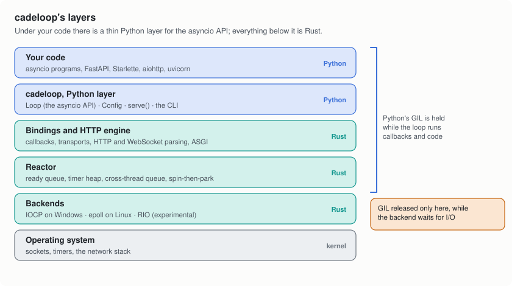
</picture>

The loop holds the GIL except while it waits for I/O, batches a connection's
writes into one system call per tick, spins briefly before sleeping when
that pays off, and on Windows uses I/O completion ports directly, with
precise timers. As a server, it keeps HTTP out of Python entirely:

<picture>
  <source media="(prefers-color-scheme: dark)" srcset="https://raw.githubusercontent.com/cadezawacki/cadeloop/main/docs/learn/img/request-path-dark.svg">
  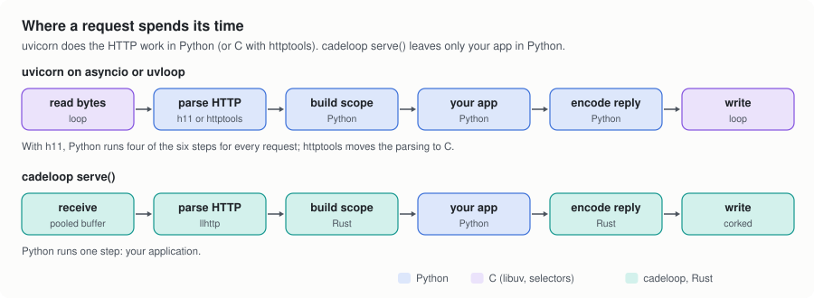
</picture>

[docs/architecture.md](docs/architecture.md) and the
[engineering record](docs/README.md) have the details for contributors.

---

## Development

```bash
cargo test --workspace                                    # Rust tests
cargo check -p cadeloop-core --target x86_64-pc-windows-msvc

cargo build -p cadeloop-pyshim --release                  # the extension
cp target/release/lib_core.so python/cadeloop/_core.so    # Linux: use it in place
pip install pytest pytest-timeout uvicorn aiohttp trustme starlette fastapi
PYTHONPATH=python pytest tests/unit tests/conformance

pip install maturin && maturin build --release            # a wheel
python tests/conformance/run_cpython_suite.py             # CPython's asyncio tests
```

Layout: `crates/core` (reactor and backends), `crates/pyshim` (bindings and
the HTTP engine), `python/cadeloop` (the Python package), `vendor/llhttp`,
`tests/`, `bench/` (load generator and benchmark suites), `docs/`.

Releases and packaging: [docs/ops.md](docs/ops.md).

---

## License

MIT, see [LICENSE](LICENSE). No GPL dependencies, checked by `cargo deny`.
