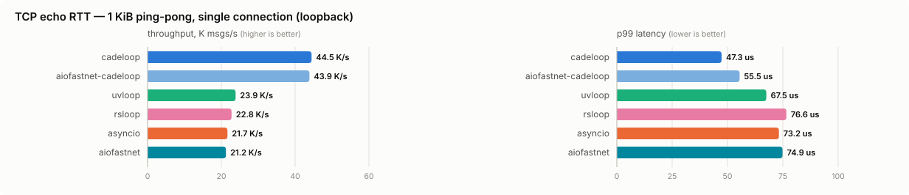
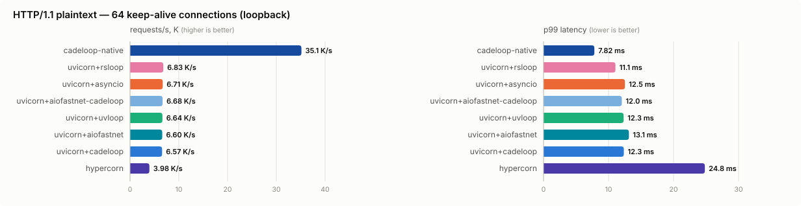

# cadeloop — engineering record

*This was the project README until the user-facing one replaced it. It is
kept as the detailed engineering record: the hardening log, milestone
status, the full benchmark history (including the Windows/IOCP runs,
which the top-level README does not repeat), and the architecture notes.*

*Looking for install instructions, usage documentation, or current
benchmark numbers? See the [top-level README](../README.md). Supported
`asyncio` surface: [compatibility.md](compatibility.md). Benchmark
methodology: [benchmarks.md](benchmarks.md).*

> ### Hardening log — review backlog
>
> An external review pass (Codex on PR #1, plus a consolidated engineering
> audit) raised ~90 findings. This is the running record; it is updated as
> items land. Newest first. (A row's commit id is filled in by the next
> commit — a commit cannot contain its own hash.)
>
> **Windows pass (on `claude/windows-perf-pass`; reproduced and verified natively on Windows 11 26200, CPython 3.11.9)**
>
> | Area | Fix | Commit |
> |---|---|---|
> | IOCP | A park bounded by a timer ended on the next 15.6 ms clock interrupt (a GetQueuedCompletionStatusEx timeout is whole milliseconds, rounded to the tick): `asyncio.sleep(0.001)` took 15.5 ms, and a server whose requests await a 1 ms timer served 4.6 K req/s instead of 31.6 K. Timer-bound parks now end on a high-resolution waitable timer delivered to the port as a wait completion packet (0.5 ms overshoot, the platform's floor; `CADELOOP_COARSE_TIMERS=1` restores the old wait) | |
> | Net | Bytes the kernel had already handed to a receive were dropped when the next receive could not be posted (the peer sent, then reset): the teardown ran before the data event was dispatched, so the protocol never saw them (0/40 delivered in a deterministic repro; stdlib 40/40). The failure is now delivered after the data | |
> | Net | Hardening, not reproduced: an `ERROR_OPERATION_ABORTED` receive or send on a live transport was taken for our own cancellation (the receive side would stop without `connection_lost`; the send side re-posted). Every internal cancel marks the transport closing or lost first, and closing the socket under a transport completes its I/O with WSAECONNABORTED on Windows 11, which was already handled -- so only a foreign `CancelIoEx` could reach this. Both now fail the transport with ConnectionAbortedError, as the stdlib proactor does | |
> | HTTP | A pipelined `Expect: 100-continue` head got its interim response as soon as it was parsed -- inside an earlier request's streamed response, breaking its chunked framing. It now follows every response ahead of it, and is omitted once the body has arrived anyway (RFC 7231 5.1.1) | |
> | HTTP | HTTP/1.0 `Connection: keep-alive` was honoured but never announced, so a 1.0 client reading to EOF waited out the idle timeout | |
> | HTTP | The engine closed a connection with the peer's upload still arriving, which makes the close a reset -- and Windows discards a connection's received-but-unread data when the RST lands: a client answered 413 at headers-complete while still sending got ECONNRESET instead of the 413. The response is now followed by a FIN and the peer's input drained (discarded) until its EOF, bounded at 5 s by the timeout sweep | |
> | Perf | `http.response.body` copied every body twice (extracted into a Vec, then onto the wire buffer); it is now borrowed from the `bytes` object, and the head buffer is sized once | |
> | Perf | Every connection kept a 64 KiB receive buffer posted while idle -- committed memory on Windows, where buffer regions are committed whole: 54.6 KiB of private memory per idle keep-alive connection at 5,000 connections. Receive buffers now start at 4 KiB and grow a size class whenever a read fills one (a short read right after a full one is a message's tail and does not shrink it back): 6.6 KiB per connection, and +3-6% on most HTTP, WebSocket and echo workloads, consistent with the smaller working set | |
> | Perf | The buffer pool never returned memory on Windows (page-out was Linux-only): 5,000 idle connections closing left +324 MiB committed for good. Free slots beyond a warm set of 256 per size class are now decommitted, and recommitted when handed out again (RIO-registered and large-page regions excepted): +12 MiB | |
> | Server | `serve(workers=N)` from a virtualenv on Windows served nothing: the venv's `python.exe` is a launcher, so each connection was `socket.share()`d into the launcher's process instead of the worker's ("could not adopt a connection: the handle is invalid"), leaking a socket handle in the launcher per connection. Workers are now started as the base interpreter with `__PYVENV_LAUNCHER__`, as multiprocessing does (bpo-35797) | |
>
> **Fixed and on `claude/pipelined-parse-error-desync-k6y3tp` (continues `claude/new-session-bq3hp6`)**
>
> | Area | Fix | Commit |
> |---|---|---|
> | Server | A fork supervisor failing with workers running (a replacement fork refused by a pids limit) SIGKILLed them all: in-flight requests cut off, no lifespan shutdown; they now get SIGTERM and the grace period first | `928e28c` |
> | IOCP | Paths that closed a socket without detaching it left its record to the next socket reissued that handle value: `wire_http` failing on TLS after registering, a RIO registration failing after the inner association; a cancelled connect also updated the connect context of a possibly reissued handle, and a never-posted slot's id resolved to slot 0 (compile-checked, not run on Windows) | `4cd952d` |
> | IOCP | The slot quarantine only drained after a short dequeue, which a port with a few hundred busy connections never returns: the op slab grew by a chunk every 256 holds and kept it (2.56M slots in a 10k-tick model); a FIFO drain sentinel now releases it under any load (compile-checked, not run on Windows) | `c66e81f` |
> | ASGI | `SystemExit`/`KeyboardInterrupt` from a handler left before the request was answered and with the driver unfinished: the client waited out the grace period for an empty close; on the non-eager path the Task's done callback raised it a second time, mid-shutdown | `b53915c` |
> | ASGI | The application was called in the loop's own context, so what a synchronous `__call__` set (middleware setting the user from a header) leaked into every later request | `f8a4e1e` |
> | HTTP | A request held its connection until its coroutine returned (ADR-18, whose uvicorn-parity claim was wrong): the next keep-alive request waited for a BackgroundTask, a close-delimited response's EOF waited for it, and the dead-peer sweep cancelled it once the client left; an eager driver whose connection was reset was dropped, never cancelled or finalized. The connection is now released when the response completes, and such requests run on detached, waited for and cancelled at shutdown | `2799902` |
> | ASGI | anyio found no root task (a copied `_run_until_complete_cb`, and `serve()` ran a bare `run_forever()`), so every request that offloaded work started and stopped a worker thread (200 requests, 200 threads); pooled, a FastAPI `def` route's mean keep-alive latency went from 606-663 µs to 308-347 µs here | `67dbf83` |
> | WS | A `receive()` cancelled after the wake for an arriving frame (an `asyncio.timeout` expiring in that tick) dropped the frame: 30-36 of 1500 lost under a 10 ms timeout; the wake now only wakes, and `receive()` takes the message as it resumes | `95b1f7c` |
> | ASGI | The eager driver dropped `cancel(msg)`'s message when it latched a cancel, so anyio cancel scopes did not recognise their own (a FastAPI route under `move_on_after` answered 500), and `cancelling()`/`uncancel()` were pinned at 0 (nested timeouts sharing a deadline fired the inner one) | `0634fe5` |
> | Server | A fork worker still in its lifespan startup ignored its supervisor's death and lived on as an orphan for as long as the startup hung | `ae8dce7` |
> | Server | `lifespan.shutdown()` always waited a fixed 10s, past a short grace (into the supervisor's SIGKILL) and short of a long one | `3288338` |
> | Server | `lifespan.shutdown` went out while requests the drain could not finish were still running against the resources it closed; they are now cancelled first, as uvicorn does | `2f6541c` |
> | Server | Output the supervisor had buffered at a fork was written again by every worker's exit flush | `56c3aa4` |
> | Net | Each `write()` queued its own buffer, and a send carries 16: 256 small writes took 16 sends over 17 ticks; small writes now coalesce into the tail buffer | `f6aff28` |
> | HTTP | One pipelining client's burst (~2400 requests per 64 KiB read) ran back to back while every other connection waited; the pump now yields after 16 | `5075760` |
> | WS | Frames after the peer's Close were still parsed and queued behind `websocket.disconnect` | `b6db6b6` |
> | Perf | Buffer regions were `alloc_zeroed` (memset under mimalloc), so every slot counted against RSS from the start and a burst's growth stayed resident; they are lazily-faulted mappings on Linux with released slots paged out past a warm set (3,000 idle connections: 243 MB to 53 MB) | `179759d` |
> | ASGI | `receive()` takes its message when called, so one cancelled before it ran (`wait_for(receive(), 0)`, an aborted task group) lost the message or request body; an unawaited message now goes back to its connection | `93cfbee` |
> | Server | Graceful shutdown never cancelled an eager request in flight at the deadline (its driver is not an asyncio Task), and `close()` dropped parked handlers and waiters pending, leaking the coroutine; both are now cancelled and their cleanup runs | `9b9ec0b` |
> | ASGI | A `cancel()` reaching the eager driver mid-step waited for the next awaited future to finish by itself (forever, for one that never does); it now cancels that future, as `Task.__step` does | `9b9ec0b` |
> | ASGI | A request pipelined behind one that suspended started with that request's contextvars; a cancelled non-eager request was logged as an application error | `9b9ec0b` |
> | HTTP | `receive()` after the response was complete parked until the app returned, deadlocking an app that awaited it and holding up the next keep-alive request; it answers `http.disconnect`, as ASGI specifies | `45deebd` |
> | HTTP | Requests pipelined behind a server-initiated close or a client half-close were run, side effects included, for responses the closing connection discarded | `45deebd` |
> | HTTP | A parked 400 stopped the connection reading, so a long-poll handler never saw its client leave and the sweep held the connection | `45deebd` |
> | WS | A receiver whose wake was queued when its connection was torn down was dropped unresolved, and its task GC-destroyed while pending; it now gets `websocket.disconnect` | `5162de0` |
> | WS | Receivers left when the handler returned got `http.disconnect`; a send on a socket closing under the app (peer close, 1012 drain) raised `RuntimeError` instead of an `OSError` | `5162de0` |
> | Loop | A readiness watch cancelled through its Handle stayed registered and kept the loop spinning at full CPU | `4f251af` |
> | Loop | A second `loop.sendfile()` on a transport was accepted, displaced the first's writer watch and hung for good; it is refused, as in asyncio | `24903fb` |
> | Net | epoll sends completed only once a whole gather was written, so bytes the kernel had taken stayed counted as buffered: two peers that each wrote and drained before reading deadlocked where asyncio and uvloop do not | `3012ea2` |
> | TCP | A `create_connection` cancelled after its connect completed (a `wait_for` timeout, a Happy Eyeballs race) leaked the connected socket | `9d4e3b5` |
> | Net | `is_closing()` and `get_write_buffer_size()` raised from another thread while the loop was parked | `a4f4822` |
> | Net | Transport events were bound before the iteration's callbacks ran: data and EOF reached a protocol after `close()`/`abort()` or while paused, datagrams arrived after a datagram transport's close, `resume_writing` followed `abort()`, and bytes meant for the protocol `set_protocol()` installed (a `start_tls` ClientHello) went to the old one; events are now routed at dispatch (ADR-32) | `3daa46f` |
> | Loop | An iteration ran its due timers before the I/O its poll reported, so an idle timeout due as a request arrived won the race: uvicorn's keep-alive timeout closed the connection and lost the request; timers now run after the iteration's I/O, as in asyncio (ADR-32) | `3daa46f` |
> | ASGI | Concurrent `send()` calls parked on write backpressure displaced one another's drain future: every frame was written but only the last sender resumed, and the rest stayed pending until the app's timeout or were destroyed by the GC as pending tasks; waiters now queue and all resolve on drain or teardown | `981dafc` |
> | CI | The PGO wheel build baked a git-bash POSIX path into the instrumented binary, so Windows wrote the profiles elsewhere and the merge found nothing | `79bab8f` |
> | TLS | A peer that connected and never sent a ClientHello was never torn down: each sweep staged another unencryptable 408 while the socket and receive slot stayed held | `7069869` |
> | Loop | `sendfile` held a raw fd across suspensions: a transport closed mid-transfer could aim `os.sendfile` at whatever connection reused the number, or park forever on a dead watcher | `7069869` |
> | Server | A lifespan app raising `KeyboardInterrupt`/`SystemExit` before `startup.complete` was classified as "no lifespan support" and served through | `7069869` |
> | Server | The connection drain could spend the whole grace budget, leaving `lifespan.shutdown` to be SIGKILLed before it ran; a quarter (capped 5s) is now reserved | `7069869` |
> | Net | `create_server(sock=...)` failure closed the detached descriptor in both Python and Rust -- the second close could land on an unrelated fd; the native side is now the single owner | `7069869` |
> | ASGI | Cancelled `receive()` futures stayed parked forever, growing the waiter queue without bound (regression of the waiter-queue fix, caught by Codex on PR #4) | `d12b4fe` |
> | Loop | `subprocess_exec` rejected `os.PathLike` arguments the standard loop hands to Popen unchecked | `6ac1232` |
> | HTTP | Engine-generated errors (400/408/413/431/500...) carried an `HTTP/1.1` status line even for parsed HTTP/1.0 requests | `d70d30f` |
> | HTTP | `OPTIONS *` was normalized to `/` in the ASGI scope, indistinguishable from an OPTIONS on the root resource | `2a97321` |
> | Unix | Abstract-namespace socket addresses were reported as lossy strings instead of bytes; non-UTF-8 paths were mangled | `afb64a8` |
> | Loop | Cancelling `shutdown_default_executor()` produced a spurious `InvalidStateError` when the shutdown thread finished | `5c096bb` |
> | Net | A fatal callback error dropped the rest of its dispatch batch: other connections' events were lost for good | `4d9c231` |
> | TCP | `create_server` failed outright when one resolved address family was unavailable instead of serving the rest | `7464cd6` |
> | UDP | `allow_broadcast` + `remote_addr` connected the socket, so replies from any other source were silently dropped | `82426cb` |
> | UDP | AF_UNIX datagram paths went through the Internet resolver, and a unix sender's source address was dropped on receive | `86d609f` |
> | Loop | An exception handler raising `KeyboardInterrupt`/`SystemExit` was demoted to an unraisable warning; the loop kept running | `2813bb9` |
> | ASGI | A second concurrent `receive()` displaced the first waiter, whose awaiter then stayed pending forever | `5186907` |
> | HTTP | A pipelined parse error was answered out of order: its 400 could reach the client as (or spliced into) an earlier request's response, and valid requests parsed ahead of it in the same buffer were dropped | `e37e9ad` |
> | Loop | `run_until_complete` scheduled the coroutine before refusing to run it | `fc8da98` |
> | ASGI | `scope["asgi"]` and `scope["extensions"]` were shared process-wide and mutable | `5c0e21a` |
> | Loop | `slow_callback_duration` was absent from the facade and ignored by the core | `5c0e21a` |
> | Net | A WS read-pause re-check could remove the transport an `unwrap()` then assumed | `17aefb3` |
> | Server | Each forked worker inherited every earlier worker's readiness pipe | `17aefb3` |
> | HTTP | The head deadline killed body uploads that ran past it while actively sending | `e4e2a70` |
> | WS | A read pause taken for write pressure was never released | `e4e2a70` |
> | HTTP | A trailer leaked into the next pipelined request as its first header | `a0f02cd` |
> | Server | The stats endpoint inherited `max_body=None`, buffering any body sent to it | `a0f02cd` |
> | Net | `create_server(sock=...)` accepted a connected socket and span on failing accepts | `a0f02cd` |
> | HTTP | A connection that sent nothing never hit the head timeout | `383f049` |
> | WS | A ping flood from a peer that stops reading queued pongs without bound | `383f049` |
> | Server | The spawn supervisor kept the old restart rule the fork one had outgrown | `7649432` |
> | Windows | `SO_REUSEADDR` let another process bind a live listener; now exclusive | `7649432` |
> | Core | Sub-millisecond waits truncated to zero, busy-polling a core until the timer fired | `7649432` |
> | Server | A slow-failing worker restarted forever; the crash-loop guard never engaged | `52ca2dc` |
> | CI | Actions ran from moving tags and a branch; now pinned to commit SHAs | `becb220` |
> | HTTP | Request trailers were merged into `scope["headers"]`, smuggling a second `Host` | `7249648` |
> | WS | Empty frames cost nothing against the inbox budget, so it never bounded the queue | `7249648` |
> | WS | `Upgrade` was compared whole instead of parsed as a token list | `7249648` |
> | WS | Subprotocol offers were trimmed of spaces but not tabs | `7249648` |
> | UDP | Empty datagrams cost nothing against the send-queue cap | `7249648` |
> | Server | `serve()` reset an embedder's signal handlers to default instead of restoring them | `7249648` |
> | Config | Negative watermarks passed validation and failed later as an `OverflowError` | `7249648` |
> | Server | A lifespan that returned after `startup.complete` left the worker serving without it | `b0c2632` |
> | Transport | `sendfile` fallback counted writes a closing transport had discarded | `b0c2632` |
> | Transport | `loop.sendfile` validated none of its parameters, unlike `sock_sendfile` | `b0c2632` |
> | CI | Python was never linted: `[tool.ruff]` existed, no workflow ran it | `d096b8b` |
> | Loop | A Context that could not be entered stopped the loop instead of one callback | `1269e7c` |
> | Server | A stalled worker took unbounded connection handoffs until it ran out of handles | `14e50ec` |
> | HTTP | A non-eager spawn failure killed the worker's loop instead of failing one request | `14e50ec` |
> | WS | A receive() after teardown reported `http.disconnect` and lost the close code | `14e50ec` |
> | TLS | A failed SSL protocol build leaked the connected descriptor | `14e50ec` |
> | Windows | Native sockets were inheritable, so a child could hold the port open | `14e50ec` |
> | Server | Access-log `close()` discarded a queued record, uncounted, to fit its sentinel | `14e50ec` |
> | Server | `gc_mode='freeze'` still froze onto a caller's own permanent generation | `14e50ec` |
> | Server | `serve(host="localhost")` failed at startup: hostnames were never resolved | `b234f96` |
> | ASGI | Awaiting a foreign loop's future hung the request instead of failing it | `b234f96` |
> | WS | `Sec-WebSocket-Extensions` from the app was forwarded but never negotiated | `b234f96` |
> | Server | `serve()` never restored the collector it reconfigured | `e114bb1` |
> | Loop | `close()` never reaped the buffers of the sends it cancelled | `c567a0e` |
> | HTTP | Graceful shutdown tore down connections whose bytes were still queued | `c567a0e` |
> | Server | `close()` could not wake a `serve_forever()` it had superseded | `c567a0e` |
> | Net | Scoped IPv6 listen addresses lost their `scope_id` at bind | `c567a0e` |
> | Transport | `sendfile` fallback's position seek was skipped by a cancellation unwind | `a443086` |
> | Unix | AF_UNIX peer/sock addresses were dropped, so `get_extra_info` said `None` | `a443086` |
> | ASGI | IPv6 `client`/`server` leaked the 4-item socket form into the scope | `046d2da` |
> | HTTP | Absolute-form target: authority now overrides a conflicting `Host` | `046d2da` |
> | TLS | `SSLWantWrite` while decrypting tore down a valid session | `046d2da` |
> | Transport | `eof_received` raising left the connection half-open forever | `046d2da` |
> | Transport | `wire_stream` leaked the socket when protocol discovery failed | `046d2da` |
> | Transport | `create_connection(sock=)` accepted a datagram socket | `046d2da` |
> | Transport | `sendfile` misreported the file position after a failed transfer | `046d2da` |
> | Transport | `sendfile` fallback read files on the loop thread | `046d2da` |
> | UDP | Datagram family match compared only the first `getaddrinfo` result | `046d2da` |
> | Windows | Affinity mask overflowed above 64 CPUs, crashing those workers | `046d2da` |
> | Buffers | `SlotId` had no generation: a stale id could free a live buffer | `cd90483` |
> | OpSlab | An out-of-range `OpId` panicked before the generation check ran | `cd90483` |
> | ADR-24 | `/bg` trace markers removed; op-target breakdown kept in `stats()` | `d4cfe3e` |
> | CI | Soak + benchmark gates moved to `slow.yml`, where they are not cancelled | `48e584c` |
> | Net | A starved listener stayed deaf: the retry only ran when other I/O arrived | `999eab8` |
> | Net | Wildcard IPv6 listeners need `IPV6_V6ONLY`; `host=None` failed `EADDRINUSE` | `999eab8` |
> | Transport | `pause_reading()` still delivered the in-flight read, defeating backpressure | `999eab8` |
> | Transport | `create_server(sock=)` never called `listen()` | `999eab8` |
> | Transport | `connect` dropped IPv6 scope, so link-local peers were unreachable | `999eab8` |
> | Transport | TLS handshake cancellation left the transport attached | `999eab8` |
> | UDP | A failing `udp_open()` leaked the detached descriptor | `999eab8` |
> | Server | Lifespan crashing after startup left the worker serving | `999eab8` |
> | Config | `tfo` / `loopback_fast_path` were read by nothing | `999eab8` |
> | HTTP | ASGI `http.response.trailers` implemented and declared in the scope | `1e48aff` |
> | HTTP | Idle sweep could tear down a connection still writing its response | `1e48aff` |
> | WebSocket | `accept` could select a subprotocol the client never offered | `52347cd` |
> | Loop | `add_reader`/`add_writer` left a phantom watcher when `set_watch` failed | `e9ebd2d` |
> | Transport | Cancelling a connect left the native op running until the OS gave up | `e9ebd2d` |
> | CLI | `--max-body none` was unexpressible, so the cap could not be turned off | `e9ebd2d` |
> | UDP | Datagram endpoint resolved hostnames twice, the second time blocking the loop | `cf696dc` |
> | Transport | `data_received` exceptions left the connection open and reading | `2750ecc` |
> | Ops | Access log ran on the loop thread; now a bounded queue + writer thread | `2750ecc` |
> | Ops | `stats_endpoint` was documented since M2 but did nothing | `2750ecc` |
> | HTTP | `Expect: 100-continue` ignored; oversized declared bodies now refused early | `91a5c74` |
> | HTTP | 205 sent no framing at all, desynchronising the keep-alive stream | `91a5c74` |
> | Transport | `get_extra_info("socket")` dup kept the connection alive past close | `91a5c74` |
> | Server | Supervisor's blocking `waitpid` never reached the grace deadline | `91a5c74` |
> | Transport | `create_server(sock=)` accepted a datagram socket | `91a5c74` |
> | TLS | Close sent no `close_notify`: strict clients got `SSLEOFError` and lost the response | `7bc7486` |
> | Transport | `get_extra_info("socket")` answered (over a dup; ownership fixed in `91a5c74`) | `2b579c7` |
> | Net | IPv6 addresses lost flowinfo/scope_id; `sendto` now takes the 4-tuple | `2b579c7` |
> | Transport | `protocol_factory` raising leaked the connected socket, one per failure | `355e82f` |
> | Net | Listener socket left open when backend registration failed | `355e82f` |
> | Config | NaN/inf durations passed the `< 0` check and disabled the guard they set | `355e82f` |
> | Pipes | Windows `data_received` exceptions left the pipe open and reading | `355e82f` |
> | Perf | Immediate-flush latency mode: selectable, honestly unmeasured | `dfe01b0` |
> | TLS | `h2` could be negotiated, then every request failed against the HTTP/1 parser | `355e82f` |
> | Server | Shutdown truncated in-flight responses; `grace` was never applied inside a worker | `65fe5c8` |
> | Server | Failed *replacement* fork left every surviving worker running unsupervised | `65fe5c8` |
> | WebSocket | Shutdown now sends a 1012 close frame instead of dropping the TCP connection | `65fe5c8` |
> | Loop | Every closed `Loop` leaked: the loop/core cycle had no `tp_traverse` | `8a11392` |
> | Perf | Native vectorcall `create_task` (-25%) / `create_future` (-11%) | `8a11392` |
> | Perf | `call_soon` validation gated behind debug, as CPython gates it (~+11%) | `4ee108e` |
> | IOCP | Recycled pipe HANDLEs skipped association (the pipe sibling of `5d96fcb`) | `5aeeb0e` |
> | UDP | `set_protocol()` now rewires the native callbacks | `5aeeb0e` |
> | Transport | `write()` after `write_eof()` raises; watermarks derive `high` from `low` | `5aeeb0e` |
> | WebSocket | Inbox budget restored when a cancelled delivery is requeued | `5aeeb0e` |
> | Net | Accepted socket leaked when `wire_http` failed (fallout from my ownership change) | `e799e9c` |
> | WebSocket | Pre-accept cap wrote a WS frame before the 101; now answers 413 | `e799e9c` |
> | HTTP | HTTP/1.1 requires exactly one `Host` (RFC 7230 5.4) | `e799e9c` |
> | UDP | `create_datagram_endpoint(sock=)` rejects stream sockets | `e799e9c` |
> | WebSocket | Inbox budget not decremented on the steady-state delivery path (stalled connections) | `09696cf` |
> | CI | ADR-24 tracing switched off after two clean Windows runs | `09696cf` |
> | HTTP | HTTP/1.0 requests now get an `HTTP/1.0` status line | `d0cdad0` |
> | WebSocket | `websocket.accept` rejects reserved handshake headers | `d0cdad0` |
> | Server | Fork supervisor cleans up workers when a later fork fails | `d0cdad0` |
> | HTTP/TLS | Staged plaintext now counted in ASGI backpressure (was inert on HTTPS) | `ee37f02` |
> | HTTP | 304 keeps its `Content-Length` (my 204 strip was too broad) | `ee37f02` |
> | Worker | Failed `http_adopt` no longer double-closes the descriptor | `ee37f02` |
> | Net | `udp_wire` / `listener_start` roll back a half-created endpoint or listener | `ee37f02` |
> | Server | Grace deadline now entered as soon as shutdown begins | `d1f471f` |
> | UDP | Endpoint torn down when `connection_made` raises | `d1f471f` |
> | HTTP | 1xx rejected on the final-response path; `Content-Length` stripped from 204 | `38cdbd9` |
> | Server | `server.sockets` returns `()` after close (was EBADF / stale dups) | `38cdbd9` |
> | Transport | Changing watermarks now re-takes the pause/resume decision | `38cdbd9` |
> | HTTP | ASGI `send()` now applies write backpressure at the watermarks | `5298130` |
> | HTTP/TLS | Pipeline bound never applied to HTTPS (repost ignored the flag) | `5298130` |
> | Loop | Close freed pipe buffers the kernel could still be writing | `5298130` |
> | epoll | Accept pool overwrote one parked slot 64x, stranding 63 slab entries | `57e0b7d` |
> | Transport | `sock_accept` fast path returned a *blocking* socket (froze the loop) | `57e0b7d` |
> | WebSocket | Post-accept inbox unbounded; now budgeted with read backpressure | `57e0b7d` |
> | Transport | `sock_sendto` returned `None` after a would-block retry | `57e0b7d` |
> | sendfile | Both fallbacks skipped the seek for `offset=0` | `57e0b7d` |
> | CI | Every commit ran twice; superseded runs never cancelled | `2b67add` |
> | HTTP | `max_body` now defaults to 16 MiB (was unbounded) → 413 | `39b73ee` |
> | Packaging | Wheels are build artifacts only; docs no longer claim otherwise | `39b73ee` |
> | IOCP | Stale `associated` set let a recycled handle skip IOCP association | `5d96fcb` |
> | HTTP | Pipelined-request queue bounded with read backpressure | `b770126` |
> | Loop | POSIX child watcher; signal disposition restored on `close()` | `3a4a764` |
> | CI | Benchmark harness and PGO training could hang forever | `3a4a764` |
> | Soak | Measured the requested duration; gates on second-half growth | `1420158` |
> | Loop | Standalone connect/pipe ops cancelled at close | `8d11d75` |
> | Server | Spawn-worker startup, address family, accept race, adoption leak | `99cde61` |
> | UDP | Send queue bounded + reported; recv recovers; queue drains on close | `a50f3d6` |
> | Net | Listener could end up with an empty accept pool and go deaf | `2b86ee9` |
> | HTTP/WS | `Transfer-Encoding` stripped, `Content-Length` enforced, status + close codes validated, pre-accept WS bytes bounded | `98f660e` |
> | TLS | Short/retryable `SSL_write` silently truncated responses | `a9961a9` |
> | Net | Cancelled ops' buffers freed while the kernel still owned them | `02c9414` |
> | HTTP/WS | WS upgrade header injection, 204/304 bodies, buffered body on half-close, absolute-form targets, `Sec-WebSocket-Key` | `df9484b` |
>
> **Open** — reconstructed from the unresolved Codex threads on PR #1
> (each with its round timestamp checked against the fix commits, so this
> list reflects what is actually unfixed, with file/line anchors):
> CONNECT requests are answered 400 by WebSocket validation before the
> app sees them (`http.rs` ~2299, needs a tunnel/close-after design);
> error responses hardcode an `HTTP/1.1` status line for HTTP/1.0
> requests (`http.rs` ~383); supervisor grace is not reserved for
> lifespan shutdown (`server.py` ~483); WS close-code state evicts after
> 64 teardowns (`net.rs` ~699); a handed-in listener fd can double-close
> (`coreloop.rs` ~1634); the spawn supervisor binds only the first
> resolved address (`server.py` ~1237); signal state is not rolled back
> when installation fails (`loop.py` ~917); datagram `sendto` does not
> resolve hostnames (`coreloop.rs` ~1667); UDP bind/connect does not
> retry remaining addrinfo candidates (`loop.py` ~706); subprocess args
> reject path-likes (`loop.py` ~1174); datagram transports expose no
> `socket` extra (`tcp.py` ~1156); `loop.sendfile` has no runtime
> fallback when `os.sendfile` fails `ENOSYS` (`loop.py` ~776); promised
> response trailers are dropped when framing is trailer-capable
> (`http.rs` ~1244); and explicit unix-path `transport.sendto(data,
> path)` on an unconnected datagram socket is unsupported (recorded
> limitation of `86d609f` — needs `netsys::Addr` through
> `post_send_to` on all three backends). Declined on evidence:
> BaseException reporting in `shutdown_asyncgens` (CPython tests
> `Exception`; the reason is recorded in the code).
>
> **Watching** — the intermittent Windows hang in
> `test_starlette_routes_and_streaming` (`/bg`) has not reproduced since
> `5d96fcb`, across every Windows run since — three confirmed clean runs
> on both runners, each including the full CPython asyncio conformance
> suite and `test_spawn_worker_pool_serves_and_stops`, which is the
> end-to-end `workers > 1` check ADR-24 was waiting on.
>
> `5d96fcb` fixes a real bug matching the signature — a recycled SOCKET
> value letting a socket skip IOCP association, so its connect completion
> was never delivered — but **the mechanism was never confirmed from a
> trace**, so this is empirically settled, not proven. The
> `CADELOOP_TRACE_TICK` / `CADELOOP_TRACE_APP` instrumentation has been
> removed now that the bar is met; `git show 999eab8~1 -- crates/pyshim`
> brings it back if it ever returns. What survives it is the op-target
> breakdown, promoted from that trace into `stats()["ops_by_target"]`:
> a stuck loop looks healthy on every other counter, and this is the one
> that says where.

A maximum-performance asyncio event loop + ASGI stack with a Rust core.
Windows (IOCP, with a Registered I/O backend implemented and awaiting
hardware validation) is the production performance target; Linux runs the same transport layer over epoll, making cadeloop a
**working drop-in `asyncio.AbstractEventLoop` replacement on both** —
uvicorn and aiohttp run on it unmodified — plus a **native HTTP/1.1 +
ASGI 3.0 server** (`cadeloop.serve`) whose parsing, scope construction,
and response serialization all happen in Rust.

```python
import asyncio, cadeloop

cadeloop.install()      # asyncio.set_event_loop_policy(cadeloop.EventLoopPolicy())
asyncio.run(main())     # everything below now runs on cadeloop:

server = await asyncio.start_server(handler, "0.0.0.0", 8000)
reader, writer = await asyncio.open_connection("example.org", 443, ssl=ctx)
loop.add_reader(fd, callback)      # readiness, sock_*, signals — all live
```

```bash
# the native ASGI server (llhttp in Rust, 5.6x uvicorn on loopback):
python -m cadeloop myapp:app --port 8000
```

## Status

**M0–M4 complete; M5 (1.0) underway.** Scheduling core, Rust TCP
transports, the full drop-in surface, native TLS termination, UDP,
WebSockets, the native HTTP/ASGI engine (Starlette/FastAPI verified),
multi-worker serving on both process models, and POSIX subprocess are
all implemented and tested. The Windows IOCP backend is
hardware-validated (full test sweep + benchmarks); the M3 Registered
I/O backend awaits a machine whose OS RIO subsystem works (see the
Windows benchmarks section). Remaining: Windows subprocess pipes, PGO
wheels, docs floor, and the two-machine acceptance runs. Full R-xxx
map: [docs/requirements-traceability.md](requirements-traceability.md).

| Surface | State |
|---|---|
| Scheduling (call_soon, timers, threadsafe, tasks) | ✅ tested |
| TCP transports, `create_server`/`create_connection`, streams | ✅ tested (Linux/epoll; Windows/IOCP compile-verified) |
| TLS: native termination on the engine (`serve(ssl=...)`, https/wss) | ✅ tested (Rust-driven `wrap_bio` memory-BIO; client `ssl=`/`start_tls` via stdlib sslproto) |
| `sock_*`, `add_reader`/`add_writer`, signals (SIGINT/SIGBREAK incl. idle-park delivery) | ✅ tested |
| Drop-in: uvicorn (HTTP/1.1), aiohttp | ✅ interop-tested |
| Native HTTP/1.1 + ASGI engine (`cadeloop.serve`, CLI, lifespan) | ✅ tested (Starlette/FastAPI, keep-alive/pipelining, chunked, limits, R-080 timeouts, access log) |
| WebSockets (RFC 6455 on the native engine) | ✅ tested (handshake/frames/close vs hand-rolled RFC client; Starlette WebSocketRoute) |
| UDP datagram endpoints (`create_datagram_endpoint`) | ✅ tested (native recv_from/send_to on both backends) |
| Multi-worker (`--workers N`) | ✅ tested (fork + SO_REUSEPORT on POSIX; spawn + shared listener — WSADuplicateSocketW on Windows, fd-passing e2e test) |
| RIO backend (`backend="rio"`: CQ/RQ, registered buffers, staging) | 🔶 implemented; blocked by an OS-level RIO failure on the test machine (Win11 beta 26200) — `auto` stays IOCP; see Windows benchmarks |
| Subprocess + pipes (`create_subprocess_exec/shell`) | ✅ tested on POSIX (Windows: M5, IOCP named pipes) |
| Native `loop.sendfile` | M1-Windows (`sock_sendfile` fallback ✅) |

## Benchmarks (Linux, loopback)

> **Scope.** Everything below is measured on one machine over loopback
> (Linux 6.18, 4 vCPU Intel Xeon 2.10 GHz, CPython 3.11.15) with client
> and server sharing the box — useful for relative comparison, **not** the
> spec's acceptance numbers, which are two-machine Windows runs against
> winloop (R-131). Methodology per R-130: 3 warmup + 5 measured runs,
> medians reported, fresh process per run, loop-independent (threaded,
> non-asyncio) load generators. Contenders: stdlib asyncio 3.11.15,
> uvloop 0.22.1, rloop 0.3.1, rsloop 0.1.30, aiofastnet 1.0.5 (both
> standalone on asyncio and stacked on cadeloop), hypercorn 0.18, and
> cadeloop's own native ASGI server. Raw JSON lives in
> [`bench/baselines/`](../bench/baselines/). Reproduce with
> `python bench/harness/harness.py --suite {sched,echo,http}`.

### Scheduling core

<picture>
  <source media="(prefers-color-scheme: dark)" srcset="assets/bench-sched-dark.svg">
  
</picture>

Median throughput, millions of ops/second:

| benchmark | cadeloop | asyncio | uvloop | rloop | rsloop |
|---|---|---|---|---|---|
| call_soon_chain | 3.42 | 0.56 | 1.64 | 4.19 | 4.92 |
| call_soon_burst | 3.42 | 0.92 | 1.47 | 3.14 | failed¹ |
| timer_schedule_cancel | **2.72** | 0.55 | 0.54 | 1.81 | failed¹ |
| timer_fire | **1.89** | 0.36 | 1.45 | 1.79 | failed¹ |
| sleep0_chain | 1.63 | 0.46 | 0.97 | 1.80 | 1.71 |
| task_spawn | 0.30 | 0.22 | 0.27 | 0.31 | 0.26 |
| threadsafe_throughput | 3.33 | 0.16 | 1.75 | **4.77** | 2.94 |
| future_chain | 1.01 | 0.25 | 0.63 | 1.15 | 1.00 |
| gather_fanin | 0.28 | 0.19 | 0.29 | 0.31 | 0.27 |
| queue_pingpong | 1.29 | 1.24 | 1.30 | 1.36 | 1.17 |

- **vs stdlib asyncio: faster on 10/10** (1.04x–20.8x). **vs uvloop:
  faster on 8/10** with two ~3% ties (gather_fanin, queue_pingpong —
  stdlib Task/Queue Python code dominates those for every loop). The
  timer benches (5x uvloop on schedule/cancel) and cross-thread wakeups
  are the standouts.
- These numbers include the competitive-analysis round: adopting rloop's
  tick anatomy (one state-cell entry per pure-scheduling tick) took the
  call_soon chain from 3.15 to 3.42–3.64 M ops/s and threadsafe
  throughput from 2.58 to 3.3+. rloop's remaining threadsafe lead is a
  semantic shortcut we declined: it reuses a loop-init context snapshot
  instead of capturing the caller's contextvars per call (ADR-22).
- The other Rust loops are honest company: rloop wins cross-thread
  wakeups, rsloop wins the call_soon chain. Both are experimental
  schedulers without a working socket layer (rloop has no
  `create_server`; ¹rsloop 0.1.30 hung reproducibly on three benches at
  full scale and is recorded as failed — the harness kills runs at 90s).

### TCP echo — per-message loop overhead

<picture>
  <source media="(prefers-color-scheme: dark)" srcset="assets/bench-echo-dark.svg">
  
</picture>

Single connection, 1 KiB ping-pong (RTT measures the full transport +
loop wakeup path; no client saturation):

| loop | msgs/s | p50 RTT | p99 RTT |
|---|---|---|---|
| **cadeloop** | **44.5K** | **21.0 µs** | **47.3 µs** |
| aiofastnet on cadeloop | 43.9K | 21.0 µs | 55.5 µs |
| uvloop | 23.9K | 40.1 µs | 67.5 µs |
| rsloop | 22.8K | 43.6 µs | 76.6 µs |
| asyncio | 21.7K | 46.0 µs | 73.2 µs |
| aiofastnet (on asyncio) | 21.2K | 45.7 µs | 74.9 µs |

**1.86x uvloop's single-stream throughput at half the p50 latency and
30% lower p99.** Two designs compound here: R-060 spin-then-park (the
reply usually lands inside the 20 µs spin window, skipping the park/wake
cycle every other loop pays per message), and the ADR-21 steady-state
recv path — one `recv` syscall per message, zero `epoll_ctl`.

The aiofastnet rows are the control experiment that *drove* that second
design. aiofastnet patches only the networking calls (Cython transports
over `add_reader`) and keeps the host loop's scheduler. An earlier run
had the stacked "aiofastnet-on-cadeloop" configuration ~10% AHEAD of our
own transports, which isolated three wasted syscalls per message in the
epoll proactor emulation (a DEL/ADD `epoll_ctl` pair plus a speculative
recv). Mirroring the readiness-transport pattern (lazy kernel interest +
a drained-socket heuristic, ADR-21) closed the gap and moved us ahead —
while the stack still runs unmodified on top of cadeloop, which is the
drop-in claim demonstrated from an unusual angle. Windows/IOCP never had
this hop; completions are the kernel's native interface there.

At 64 concurrent connections on this 4-vCPU box the *client* saturates
first and every contender converges into the 40.5–43.9K msgs/s band —
that configuration measures the load generator, and only a two-machine
run can separate the servers.

### HTTP/1.1 — the native engine vs everything else

<picture>
  <source media="(prefers-color-scheme: dark)" srcset="assets/bench-http-dark.svg">
  
</picture>

Plaintext "Hello, World!" ASGI, 64 keep-alive connections. `cadeloop-native`
is `cadeloop.serve()` — the M2 engine: llhttp parses inside the Rust
core, the scope is built natively, the app coroutine is stepped eagerly
(no asyncio Task for a request that never suspends, R-056), and the
response is serialized in Rust straight into the corked write queue. The
uvicorn rows run uvicorn (h11) **unmodified** on each loop:

| contender | req/s | p50 | p99 |
|---|---|---|---|
| **cadeloop native** (`cadeloop.serve`) | **40.96K** | **0.98 ms** | **7.20 ms** |
| cadeloop native, 2 workers² | 36.50K | 1.16 ms | 7.82 ms |
| uvicorn + asyncio | 7.60K | 8.42 ms | 10.4 ms |
| uvicorn + aiofastnet | 7.48K | 8.47 ms | 13.3 ms |
| uvicorn + rsloop | 7.41K | 8.63 ms | 10.5 ms |
| uvicorn + uvloop | 7.36K | 8.63 ms | 11.1 ms |
| uvicorn + cadeloop | 7.11K | 8.91 ms | 11.4 ms |
| uvicorn + aiofastnet-cadeloop | 7.09K | 8.81 ms | 13.7 ms |
| hypercorn + asyncio | 4.46K | 14.1 ms | 18.2 ms |

**5.6x uvicorn+uvloop's throughput at 8.8x lower p50 latency** — the
spec's ≥2x-uvicorn target (R-002) cleared with headroom on this box
(the acceptance measurement itself remains a two-machine Windows run,
R-131). Honest notes: the uvicorn pack sits within ±4% — h11's
Python-side parsing flattens *any* loop's advantage, which is why the
native engine exists — and this is the same app, same client, same
methodology, so the 5.6x is pure server-stack difference, not tuning.
²The multi-worker row is slower than one worker HERE because client and
server share 4 vCPUs: two server workers steal a core from the threaded
load generator, which is the actual bottleneck — worker scaling is a
two-machine measurement, and this row exists to prove the SO_REUSEPORT
pool serves correctly under load, not to measure it. The engine passes
the same ASGI suites as the drop-in path: Starlette (including streaming
responses and background tasks) and FastAPI run on it unmodified
(R-123). (socketify.py, the intended C-level reference ceiling, hangs on
import in this container and is excluded.)

### Three findings from building these benchmarks

- Benchmarks are tests: the first echo runs exposed two real transport
  races (data loss on `pause_reading` with an in-flight completion; slot
  reuse corrupting streams) — both fixed with a design change (pausing
  cancels nothing) plus kernel-op buffer refcounts (R-073), and now
  covered by the 10 MB-transfer test.
- Benchmarks are regression gates: the M1 transport work initially taxed
  every scheduling tick ~430 ns; three fast-path fixes (skip `epoll_wait`
  on idle zero-timeout polls, keep the GIL for non-blocking reaps, one
  clock read per tick) restored M0 numbers exactly, and one state-cell
  entry removed from `transport.write` took uvicorn+cadeloop from 10%
  behind uvicorn+uvloop to ahead of it.
- Benchmarks are competitive analysis: benching aiofastnet *stacked on*
  cadeloop (echo table above) exposed a ~10% transport-layer cost ours
  pays on the epoll dev backend and handed us the M2.5 fix for free;
  benching rsloop's `#[pyclass(freelist)]` trick the same way showed it
  *doubling* call_soon cost under pyo3 (the freelist locks) — adopted
  findings and rejected ones both end up as ADRs (16, 20).

## Benchmarks (Windows 11, loopback)

Current Windows numbers -- HTTP, WebSocket, TLS, TCP echo, timers,
scheduling, memory per connection, overload and recovery, with charts --
are in the [top-level README](../README.md#windows-11-iocp), measured with
the native harness in [`bench/windows/`](../bench/windows/README.md);
methodology in [benchmarks.md](benchmarks.md#windows). The summary data
behind them is in [`bench/baselines/windows-2026-10/`](../bench/baselines/windows-2026-10/).

The figures that stood here until October 2026 (cadeloop-native 34.7 K
req/s, 64-connection echo 41.2 K msg/s, single-connection echo 30 µs p50)
came from the Python load generator that [benchmarks.md](benchmarks.md#trap-1--the-load-generator-was-the-bottleneck)
shows to be GIL-bound, and are superseded. On the same machine, the native
generator measured cadeloop-native at 73.7 K req/s for the then-current
1.0.1 build -- but only with the host's network-filtering software paused:
with AdGuard's and a VPN client's WFP drivers active, loopback TCP capped
*every* server at ~14 K round trips/s (trap 4 in benchmarks.md).

### RIO status on this machine

The RIO backend (`backend="rio"`) could not be behaviorally validated
on the test machine: on its Windows 11 Insider build (26200.9168) the
OS's RIO subsystem itself fails to initialize — every kernel-touching
RIO entry point (`RIORegisterBuffer`, `RIOCreateCompletionQueue` under
all notification variants) returns WSAEFAULT from calls whose argument
lists contain no pointer, with the function table verified to resolve
from genuine unhooked `mswsock.dll`, an LSP-free Winsock catalog, and a
native-x64 process. The full diagnosis lives in
[`crates/core/examples/rio_probe.rs`](../crates/core/examples/rio_probe.rs)
(run it on any Windows box for a verdict in seconds). `backend="auto"`
stays on IOCP; the validation orchestrator detects the condition in 2s
and skips RIO steps. Behavioral validation waits for a stable x64 build
(23H2/24H2 or Server).

## Architecture

```
L4  Python user code / ASGI app
L3  python/cadeloop — Loop facade, policy, Config, CLI       [Python]
L2  crates/pyshim   — transports, listeners, bindings        [Rust]
L1  crates/core     — reactor: timers, queues, dispatch      [Rust]
L0  crates/core     — IOCP | RIO (hybrid) | epoll (Linux)    [Rust]
```

Highlights (details in [docs/architecture.md](architecture.md),
decisions in [docs/decisions.md](decisions.md)):

- **One completion-style op API over both kernels** — IOCP natively;
  epoll wrapped as a proactor (syscall attempted at post time, parked
  only on EWOULDBLOCK) so a single Rust transport layer serves both.
- **One thread, one conditional GIL release per tick**: the kernel poll
  drops the GIL only when it can actually block; completions dispatch in
  batches via vectorcall with per-connection protocol callbacks cached as
  bound methods.
- **Cancel-safe by construction**: pinned op slabs with a
  `{Free, Posted, Completed, Cancelled}` state machine (property-tested),
  buffer slots refcounted by kernel ops and memoryview exports alike, and
  a graveyard protocol so no Python object can be dropped — and no
  `__del__` can re-enter — inside the loop's critical section.
- **Corked gather writes** (R-035): writes coalesce within a tick into
  ≤16-slice `writev`/`WSASend` calls, flushing at tick end, at 64 KiB, or
  on drain; `bytes` payloads are retained zero-copy (R-074).

## Development

```bash
cargo test --workspace                                    # Rust core (59 tests)
cargo check -p cadeloop-core --target x86_64-pc-windows-msvc

cargo build -p cadeloop-pyshim --release                  # extension
cp target/release/lib_core.so python/cadeloop/_core.so    # Linux dev shortcut
pip install pytest pytest-timeout uvicorn aiohttp trustme starlette fastapi
PYTHONPATH=python pytest tests/unit tests/conformance     # 112 tests

pip install maturin && maturin build --release            # the real wheel
python tests/conformance/run_cpython_suite.py             # CPython asyncio suite
```

Repo layout follows the spec (R-114): `crates/core`, `crates/pyshim`,
`python/cadeloop`, `vendor/llhttp`, `tests/{unit,conformance,stress}`,
`bench/{echo,http,sched,harness}`, `docs/`.

## License

MIT (no GPL dependencies — enforced by `cargo deny`).
