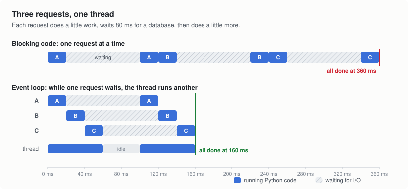
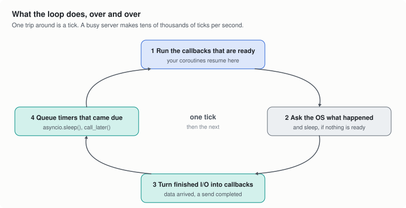
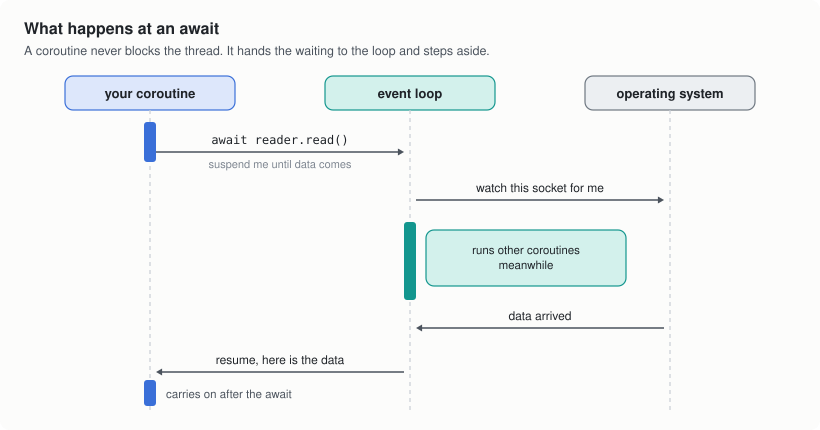

# 1. What an event loop does

A web server spends most of its life waiting. A request comes in, your code
asks a database for a row, and then nothing happens for a few milliseconds
while the database works. The row comes back, your code builds a reply, and
the reply travels back over the network. Seen from the CPU, a request is a
short burst of work, a long wait, and another short burst.

There are two classic ways to keep the CPU busy while requests wait.

**One thread per request.** While one thread waits, the operating system
runs another. The code is easy to follow, since each request reads top to
bottom. But every thread has its own stack, switching between threads
costs time, and in CPython only one thread runs Python code at a time (the
GIL). Ten thousand open connections means ten thousand threads, mostly
asleep.

**An event loop.** One thread, and it never waits on any single request.
When a request has to wait, it records what it is waiting for and steps
aside, and the thread moves on to a request that can make progress. When
the thing it was waiting for happens, the request continues from where it
stopped.

<picture>
  <source media="(prefers-color-scheme: dark)" srcset="img/blocking-vs-loop-dark.svg">
  
</picture>

The blocking version finishes three requests in 360 ms because each one
waits behind the previous one's database call. The event loop runs the
three waits at the same time and finishes in 160 ms, on the same single
thread. The thread is only idle when every request is waiting.

That is the whole idea. asyncio is Python's framework for writing code this
way, and its event loop is the part cadeloop replaces.

## The loop itself

An event loop is a short routine that runs over and over:

<picture>
  <source media="(prefers-color-scheme: dark)" srcset="img/loop-cycle-dark.svg">
  
</picture>

1. Run every callback that is ready. In asyncio, resuming a coroutine is a
   callback, so this is where your code runs.
2. Ask the operating system what happened since last time. If nothing is
   ready to run, sleep here, but only until the next timer is due.
3. Turn what the OS reported (data arrived, a connection was accepted, a
   send finished) into callbacks for the next round.
4. Move timers that are now due into the ready list.

One trip around is called a **tick**. An idle loop spends nearly all its
time asleep in step 2. A busy one goes around tens of thousands of times a
second.

## What `await` actually does

When a coroutine awaits something that isn't finished, it doesn't block the
thread. It returns control to the loop, along with a note about what it is
waiting for.

<picture>
  <source media="(prefers-color-scheme: dark)" srcset="img/await-sequence-dark.svg">
  
</picture>

```python
async def handle(reader, writer):
    data = await reader.read(1024)   # suspends here until bytes arrive
    writer.write(data.upper())       # resumes here, on a later tick
    await writer.drain()
```

Between those two lines the loop runs other coroutines. Nothing in your
code makes that happen except the `await`; it is the handoff point.

It is also why one blocking call hurts every connection at once.
`time.sleep(1)`, a synchronous database driver or a slow CPU-bound loop
inside a coroutine stops the whole event loop for that long, because the
loop only gets control back at an `await`. Put blocking work on a thread
with `await asyncio.to_thread(func, ...)`.

## Where the time goes

For a Python web service, the time per request splits into three parts:

- **Your application:** routing, validation, database calls, building the
  response.
- **The server around it:** parsing the HTTP request, building the `scope`
  dict that ASGI passes to your app, encoding the response.
- **The event loop and the OS:** waiting for I/O, moving bytes between
  sockets and memory, running callbacks.

The second and third parts cost the same on every request, whatever your
app does. As a drop-in loop, cadeloop speeds up the third part. With
`cadeloop.serve()` it also moves most of the second part out of Python. Your
code is the same code either way.

Next: [How the operating system reports I/O](2-talking-to-the-os.md)
