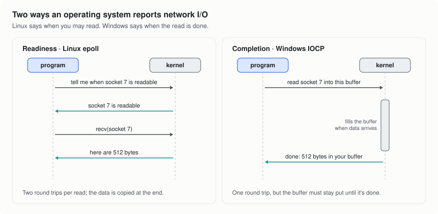

# 2. How the operating system reports I/O

Step 2 of every tick asks the OS what happened. Operating systems answer in
one of two styles, and the difference shapes how an event loop is built.

<picture>
  <source media="(prefers-color-scheme: dark)" srcset="img/readiness-vs-completion-dark.svg">
  
</picture>

## Readiness: Linux

On Linux, a program registers the sockets it cares about with `epoll` and
then asks which of them are usable. The kernel answers with a list such as
"socket 7 has data to read" or "socket 9 has room to send". The program then
makes the actual `recv()` or `send()` call, which copies the bytes between
the kernel and the program's memory.

Each read is two steps: learn that you can read, then read. The upside is
that the program only hands out memory for a read once there is data to
put in it.

## Completion: Windows

Windows works the other way round, through I/O completion ports (IOCP). The
program starts the operation up front ("read from socket 7 into this
buffer") and carries on. When data arrives, the kernel fills the buffer and
posts a note to the port: "the read on socket 7 finished, 512 bytes". The
program collects these notes when it checks the port.

That saves the second step, and the kernel can put data straight into the
program's buffer. The price is bookkeeping: the buffer has to stay
allocated, at the same address, from the moment the read starts until it
completes, which for an idle keep-alive connection can be minutes. A server
built on completions has to work to keep memory per idle connection down.

## Why this mattered for Python on Windows

asyncio ships a loop for each style: `SelectorEventLoop` (readiness) and
`ProactorEventLoop` (completion, the Windows default). The popular fast
replacement, uvloop, is built on libuv and does not run on Windows; winloop
is a port of it that does.

cadeloop was built for Windows first. Its core is an IOCP loop written in
Rust, and its Linux backend keeps the same completion-style interface on top
of epoll, so the code above the backend is the same on both systems.

## How cadeloop fits both models

Everything in cadeloop above the backend thinks in completions: "this read
finished, here are the bytes".

- **On Windows** that is native. When an operation finishes at once,
  cadeloop also skips the trip through the completion port
  (`FILE_SKIP_COMPLETION_PORT_ON_SUCCESS`), which saves a kernel round trip
  on busy connections.
- **On Linux** the epoll backend imitates it. When a read is started, it
  tries the `recv()` immediately, which often succeeds because the data is
  already waiting. Only if the socket has nothing yet does it register
  interest with epoll and finish the read on a later tick.

Either way, the layers above see one stream of finished operations. That is
what lets the same reactor, the same transports and the same HTTP server run
on both systems.

The memory cost of completions is also why cadeloop sizes each receive
buffer by what the connection has recently been receiving, and keeps a pool
of them (see [Inside cadeloop](3-inside-cadeloop.md#buffers)). In the
Windows benchmarks, 5,000 idle keep-alive connections cost cadeloop about
6.6 KiB each.

Next: [Inside cadeloop](3-inside-cadeloop.md)
