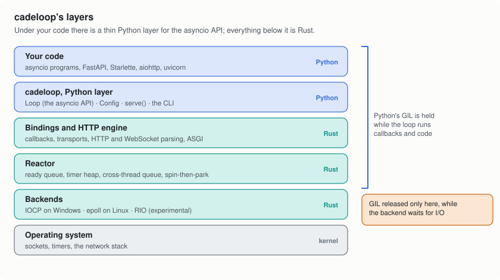
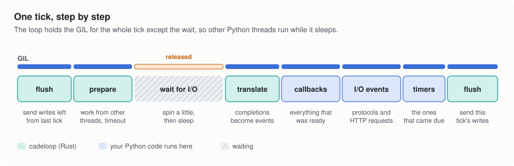
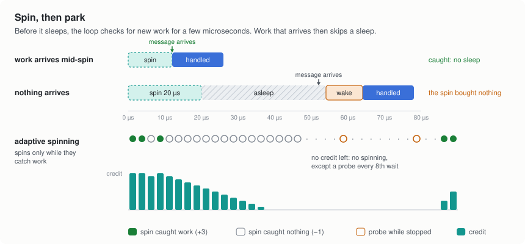
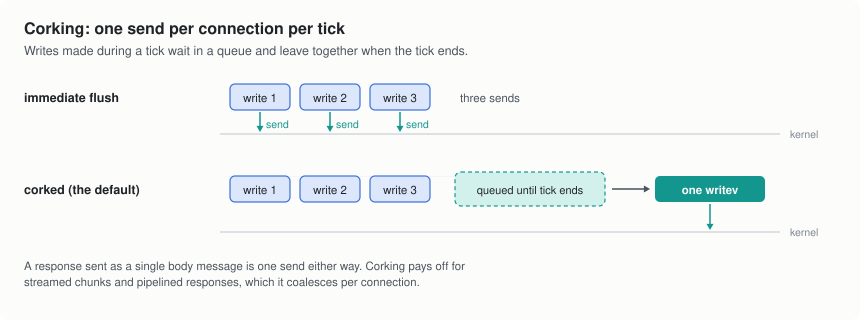
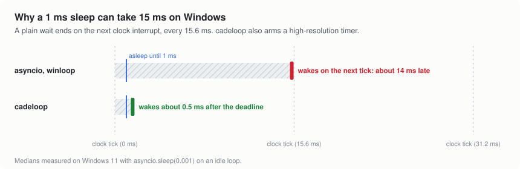
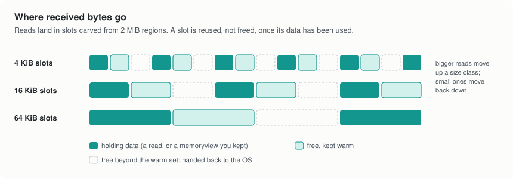

# 3. Inside cadeloop

<picture>
  <source media="(prefers-color-scheme: dark)" srcset="img/layers-dark.svg">
  
</picture>

Under your code, cadeloop has four layers:

- **The Python layer** ([`python/cadeloop`](../../python/cadeloop)) is what
  you import. `Loop` subclasses `asyncio.AbstractEventLoop`, so asyncio's
  tasks and futures, and the libraries built on them, work unchanged. The
  frequently called methods, such as `call_soon` and `call_later`, go
  straight to Rust; occasional ones, like DNS lookups and executors, are
  plain Python.
- **The bindings and HTTP engine** ([`crates/pyshim`](../../crates/pyshim))
  connect Python to the core. They hold your callbacks, run the transports
  that `asyncio.Protocol` code uses, and contain the HTTP/1.1 and WebSocket
  server behind `cadeloop.serve()`.
- **The reactor** ([`crates/core`](../../crates/core)) is the loop proper:
  the queue of ready callbacks, a timer heap, a queue for work handed over
  by other threads, and the rules for when to wait and for how long. It
  knows nothing about Python.
- **The backends** talk to the OS: IOCP on Windows, epoll on Linux, and RIO
  (Windows' registered I/O), which is experimental and needs an explicit
  opt-in.

## One tick, step by step

<picture>
  <source media="(prefers-color-scheme: dark)" srcset="img/tick-dark.svg">
  
</picture>

A cadeloop tick does the four jobs every event loop does, in this order:

1. Send the writes that the last tick's callbacks queued (see
   [corking](#corking-writes)).
2. Collect work that other threads handed over with
   `call_soon_threadsafe()`, and work out how long the loop may wait: not at
   all if something is ready, otherwise until the next timer.
3. Wait for I/O. This is the only point where cadeloop releases Python's
   GIL, so other Python threads in the process run while the loop sleeps.
4. Turn the completions the OS reported into events.
5. Run the callbacks that were ready when the tick began, then the protocol
   and HTTP events from this tick's I/O, then the timers that came due. That
   is asyncio's own order, so code that relies on it keeps working.
6. Send the writes this tick produced.

Everything but your callbacks runs in Rust, and the loop takes the GIL back
once per tick, not once per event.

## Spin, then park

Falling asleep and waking up takes time: anywhere from a few microseconds to
tens of microseconds, depending on the machine. When requests arrive in a
steady stream, the next one often lands just after the loop decided to
sleep. So before it sleeps, cadeloop keeps checking for new work in a tight
loop for a short window, 20 µs by default. Work that arrives in that window
is handled at once, without a sleep and a wake-up.

<picture>
  <source media="(prefers-color-scheme: dark)" srcset="img/spin-then-park-dark.svg">
  
</picture>

Spinning costs CPU when nothing comes. So by default cadeloop keeps score: a
spin that catches work earns three credits, one that catches nothing spends
one, and when the credit runs out it stops spinning and sleeps straight
away, trying one spin every eighth wait to notice when traffic picks up
again. With steady traffic it keeps spinning; with sparse traffic it mostly
doesn't. Work that was already waiting when a spin began doesn't count as a
catch, since a sleep would have ended just as fast.

`latency_mode` picks the window (0, 20 or 200 µs) and whether this check is
on. `loop.stats()` reports `spins` and `spin_hits`, so you can see how often
spinning pays off on your traffic.

## Corking writes

<picture>
  <source media="(prefers-color-scheme: dark)" srcset="img/corking-dark.svg">
  
</picture>

When your code writes to a connection, cadeloop doesn't send the bytes right
away. It queues them, and at the end of the tick sends everything queued for
that connection with one `writev()`. A response written as one message is a
single send either way; streamed responses and pipelined requests make
several writes per tick, and those go out together.

The `immediate_flush` option sends every write at once instead. On Linux
loopback that measured as a net loss (less throughput, more CPU per
request), so it is off except under `latency_mode="spin"`.

## Timers on Windows

<picture>
  <source media="(prefers-color-scheme: dark)" srcset="img/timer-resolution-dark.svg">
  
</picture>

Windows wakes sleeping threads on a clock interrupt that fires every
15.6 ms by default. A loop that sleeps with a 1 ms timeout wakes on the next
interrupt instead, so `asyncio.sleep(0.001)` takes about 15 ms on asyncio and
winloop. When a cadeloop wait ends at a timer, it also arms a
high-resolution timer for that deadline, and the wait ends about half a
millisecond after the deadline. Under load nothing sleeps for long, so every
loop is on time; the difference shows on lightly loaded servers and in code
that sleeps briefly.

## Buffers

<picture>
  <source media="(prefers-color-scheme: dark)" srcset="img/buffer-pool-dark.svg">
  
</picture>

Received data lands in slots cut from 2 MiB memory regions, in three sizes:
4 KiB, 16 KiB and 64 KiB. A connection whose reads keep filling its slot
moves up a size, and one that receives little moves back down. A slot whose
data has been used goes back on a free list instead of to the allocator, so
a busy server doesn't allocate memory for every read. Up to 256 free slots
per size stay ready; after a burst, the memory beyond that goes back to the
OS. On Windows, a region's memory is committed slot by slot, as slots are
first used.

`loop.stats()` reports `buffers_in_use`, `buffer_bytes_in_use` and
`buffer_bytes_held`.

## Why the hot path needs no locks

A cadeloop loop belongs to the one thread running it, the same rule asyncio
has. Other threads hand work over with `call_soon_threadsafe()`, which goes
through a lock-free queue and wakes the loop if it is asleep. Everything else
can assume it is on the loop's thread, so the frequent operations are plain
memory updates rather than lock acquisitions.

Next: [The HTTP server](4-the-http-server.md)
