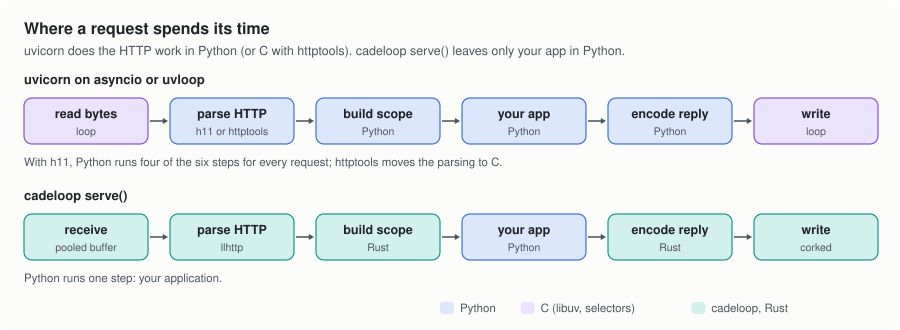
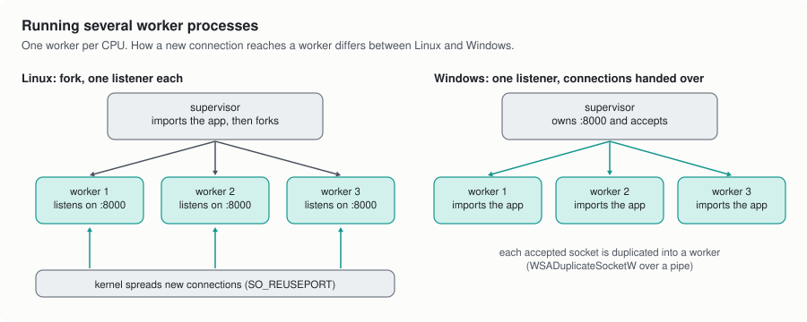

# 4. The HTTP server

`cadeloop.serve()` runs ASGI applications, the same kind uvicorn, hypercorn
and granian run: FastAPI, Starlette, Litestar, Django's ASGI handler, or a
plain `async def app(scope, receive, send)`. The difference is in what
happens around your app on every request.

<picture>
  <source media="(prefers-color-scheme: dark)" srcset="img/request-path-dark.svg">
  
</picture>

With uvicorn, bytes arrive through the event loop's transport and uvicorn's
protocol class parses them: in pure Python with h11, or with httptools, a C
binding to the llhttp parser. uvicorn then builds the `scope` dict, calls
your app, and turns the `http.response.start` and `http.response.body`
messages your app sends back into bytes. All of that is Python.

With `cadeloop.serve()`, none of it is. The bytes land in one of the loop's
buffers, llhttp parses them in place, called from Rust, and Rust builds the
scope and calls your app. When your app sends its response messages, Rust
checks them and writes the response bytes into the connection's write queue.
The only Python on the request path is your application.

## Requests start eagerly

Most handlers finish without ever really waiting: they compute a response
and return. cadeloop runs your app as soon as the request is parsed, inside
the same tick, until it either finishes or reaches an `await` that has to
wait. A request that never waits never creates an asyncio Task. One that does
wait gets a small driver object that registers itself as the current task,
so libraries that look at `asyncio.current_task()`, such as anyio and
Starlette, behave as usual.

If a library depends on tasks starting later, turn this off with
`eager_tasks=False`.

## Connections, limits and bodies

Each connection is a small state machine in Rust. It handles keep-alive,
pipelined requests (answered in order, with a cap on how many may queue up
behind a slow one), `Expect: 100-continue`, chunked bodies in both
directions, trailers, and WebSocket upgrades.

Size limits on headers, header count, URL and body are checked while
parsing, before any Python runs, and a slow-request timeout closes
connections that never finish sending their request head. The request body
is read in full before your app is called, which is why `max_body` has a
finite default (16 MiB): it bounds the memory one request can take.

## TLS

TLS goes through Python's `ssl` module using memory buffers, so you pass the
same `ssl.SSLContext` you would anywhere else. The encryption itself is
OpenSSL, through Python's binding to it; parsing and everything else stays in
Rust.

## Workers

<picture>
  <source media="(prefers-color-scheme: dark)" srcset="img/workers-dark.svg">
  
</picture>

One worker is one thread on one core. For more cores, run more workers
(`workers=0` means one per CPU the process may use):

- **Linux.** The supervisor imports your app once, freezes the garbage
  collector's view of everything imported so far (`gc.freeze()`), and forks.
  The workers share those memory pages instead of each copying them. Each
  worker opens its own listening socket on the same port with
  `SO_REUSEPORT`, and the kernel spreads new connections across them.
- **Windows.** There is no `fork`. The supervisor owns the single listening
  socket, accepts connections, and passes each one to a worker with
  `WSADuplicateSocketW`. Each worker imports your app itself, so with more
  than one worker on Windows you pass the app as a `"module:attribute"`
  string rather than as an object.

Your app's lifespan runs once in each worker, so each worker opens its own
database pool, HTTP client and so on. The supervisor restarts workers that
crash and drains them gracefully on shutdown.

Next: [How cadeloop compares](5-how-it-compares.md)
