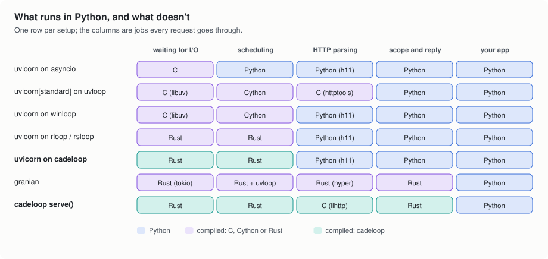

# 5. How cadeloop compares

cadeloop is two things you can use separately: an asyncio event loop, and an
ASGI server built on it. So there are two sets of neighbors to compare
against.

<picture>
  <source media="(prefers-color-scheme: dark)" srcset="img/stack-comparison-dark.svg">
  
</picture>

## As an event loop

| loop | built with | platforms | notes |
|---|---|---|---|
| asyncio | Python, with C helpers | all | The reference that every other loop copies. Selector loop (readiness) on Linux and macOS, proactor loop (IOCP) on Windows. |
| uvloop | Cython on libuv | Linux, macOS | The usual fast loop on Linux. |
| winloop | Cython on libuv | Windows | A port of uvloop to Windows. |
| rloop | Rust | Linux, macOS | |
| rsloop | Rust | Linux, macOS, Windows | |
| cadeloop | Rust | Linux, Windows | IOCP on Windows, epoll on Linux. Also a server. |

All of these speed up the same part of a request: the loop's share. The
[scheduling benchmarks](../../README.md#benchmarks) show each loop's
strengths, and the compiled loops trade places from benchmark to benchmark.
In a real application the gaps between them shrink, because most of the time
goes to Python code that no loop replaces: on a recursive task benchmark that
looks like application code (`task_fib`), the compiled loops on Linux landed
within 16% of each other, 1.4 to 1.7 times as fast as stdlib asyncio.

Where cadeloop differs as a loop:

- **Windows.** It is native IOCP rather than a port, and its timers are
  precise: `asyncio.sleep(0.001)` overshoots by about 0.5 ms instead of
  about 14 ms (see [timers on Windows](3-inside-cadeloop.md#timers-on-windows)).
- **The same loop runs a native HTTP server**, so you can start with the loop
  under your existing server and move to `cadeloop.serve()` later.
- **CPython 3.11 only**, today. uvloop and the others support more Python
  versions.

## As an ASGI server

| server | HTTP parsing | your app runs on | protocols |
|---|---|---|---|
| uvicorn | h11 (Python) or httptools (C) | asyncio or uvloop | HTTP/1.1, WebSockets |
| hypercorn | h11 and h2 (Python) | asyncio or trio | HTTP/1.1, HTTP/2, HTTP/3 (with aioquic), WebSockets |
| granian | hyper (Rust) | uvloop, rloop or asyncio | HTTP/1.1, HTTP/2, WebSockets |
| `cadeloop.serve()` | llhttp (C), driven from Rust | cadeloop | HTTP/1.1, WebSockets |

uvicorn and hypercorn keep the HTTP work in Python. granian and
`cadeloop.serve()` both move it to Rust and leave only your app in Python. In
the [Linux benchmarks](../../README.md#linux-epoll), cadeloop led every HTTP
and WebSocket workload and granian came second on most of them; with a single
connection, `uvicorn[standard]` was faster than granian.

What `cadeloop.serve()` doesn't have, so you can decide early:

- **No HTTP/2 or HTTP/3.** Put a proxy (nginx, Caddy, a cloud load balancer)
  in front to terminate them; it talks HTTP/1.1 to cadeloop, which is how
  most Python servers are deployed anyway.
- **No auto-reload** for development. Keep using `uvicorn --reload` while you
  write code, and cadeloop where you deploy; it's the same app either way.
- **CPython 3.11 and x86-64**, on Windows and Linux.

## Which to pick

- **You have asyncio code that isn't a web server** (clients, bots,
  scrapers, queue consumers): use the loop. `cadeloop.install()` before
  `asyncio.run()` is the whole change.
- **You run uvicorn and want to try cadeloop with no risk:** keep uvicorn and
  put cadeloop's loop under it. Same server, same config, faster loop.
- **You want the most requests per CPU:** `cadeloop myapp:app`, behind a
  proxy if you need HTTP/2 or TLS from the outside.
- **You need HTTP/2 inside Python**, or Python 3.12+: hypercorn or granian.

Next: [Measuring performance](6-measuring.md)
