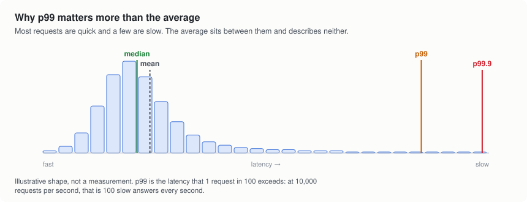
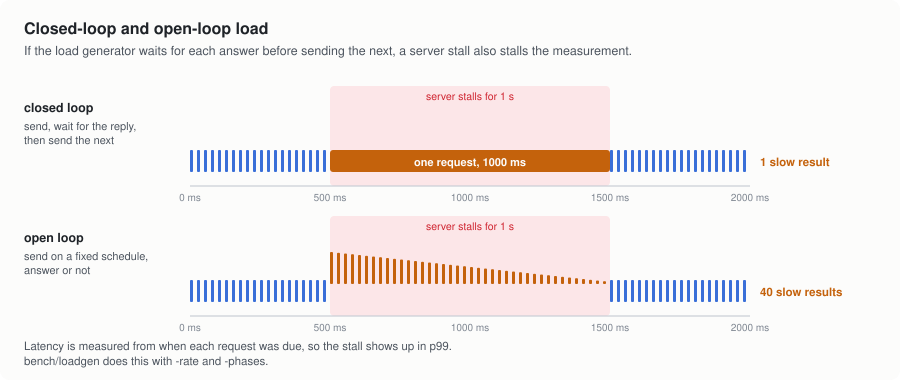
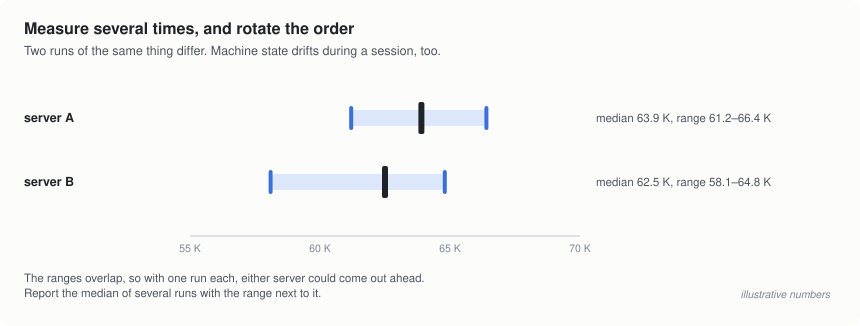

# 6. Measuring performance

Benchmarks are easy to run and easy to get wrong. This page covers what to
measure, the traps that turn numbers into noise, and how to measure your own
application.

## What to measure

- **Throughput**: requests or messages per second. Useful, but on its own it
  says nothing about how long any one request took.
- **Latency, as percentiles.** The median (p50) is the typical request. p99
  is the slowest one in a hundred, and p99.9 the slowest in a thousand.
- **CPU per request**: the CPU time the server used, divided by the requests
  it served. Throughput on a shared machine depends on whatever else is
  running; CPU per request mostly doesn't, so it is the fairest single number
  when you compare servers on a laptop or a small VM.
- **Memory**: at rest, at its peak under load, and per idle connection.
- **Errors.** A server that is faster because it drops requests isn't faster.
  Count failures separately and never fold them into throughput.

<picture>
  <source media="(prefers-color-scheme: dark)" srcset="img/percentiles-dark.svg">
  
</picture>

An average blends the fast majority with the slow few and describes neither.
Percentiles keep them apart. Merge percentiles correctly, too: the p99 of
three runs is the p99 of all three runs' measurements together, not the
average of three p99s.

## Closed loop and open loop

Most load generators, wrk and ab among them, are *closed loop*: each
connection sends a request, waits for the reply, then sends the next. If the
server stalls for a second, the load generator stops sending for that second
too, so the stall appears as one slow request instead of a second's worth of
them. This is called *coordinated omission*, and it makes servers that stall
look far better than they are.

<picture>
  <source media="(prefers-color-scheme: dark)" srcset="img/closed-vs-open-dark.svg">
  
</picture>

An *open-loop* generator sends requests on a schedule whether or not replies
come back, and measures each request's latency from the moment it was due.
A stall then shows up in p99 the way your users would feel it. The repo's
load generator, [`bench/loadgen`](../../bench/loadgen), does both: closed
loop by default, open loop with `-rate` (a fixed rate) or `-phases` (a
schedule of rates; the overload test in the README uses it).

## Repeat, and rotate

<picture>
  <source media="(prefers-color-scheme: dark)" srcset="img/noise-dark.svg">
  
</picture>

Two runs of the same benchmark differ, and a machine's speed drifts over a
session as it heats up or as background jobs come and go. On cloud VMs it
drifts more: the same benchmark on the same kind of VM measured 66% apart
between two sessions while this page was written. So:

- Run every measurement several times. Report the median with the range.
- Rotate the order of the things you compare, so drift doesn't always favor
  whoever goes first.
- Compare only numbers taken in the same session.
- Restart the server for each run, and leave out a warmup period.

[`bench/suite`](../../bench/suite) does all of this. Its README lists the
rules it follows.

## Loopback is not production

The README's numbers are loopback runs: client and server on one machine,
talking through the kernel's loopback interface. There is no network card
and no interrupt handling, and the load generator competes with the server
for CPU. Loopback is good for comparing servers under identical conditions,
not for predicting how many users a server can take.

On Windows, software that filters network traffic (VPN clients, ad blockers,
some antivirus) can cap loopback throughput for every server at once. The
Windows numbers were taken with those stopped.

## Measuring your own app

How much cadeloop helps depends on your app: the more time a request spends
in your own code, the smaller the share a faster loop or server can save.
The only way to know is to measure.

1. Start your app under your current server and under cadeloop, on different
   ports:

   ```bash
   uvicorn myapp:app --port 8000
   ```

   ```bash
   cadeloop myapp:app --port 8001
   ```

2. Build the load generator (needs Go 1.22 or newer) and load each server
   the same way, from a second machine if you have one:

   ```bash
   go build -C bench/loadgen -o loadgen .
   ```

   ```bash
   ./bench/loadgen/loadgen -port 8000 -path /your/endpoint -c 64 -d 10 -warmup 2
   ```

   It prints one `RESULT` line of JSON with requests per second, latency
   percentiles and error counts. Add `-expect-status 200` and
   `-expect-body ...` to have it check every response.

3. Watch the server's CPU while it runs (`top`, Task Manager), and compare
   CPU per request, not only throughput.
4. Run each a few times, alternating between the two.

## Reading `loop.stats()`

`loop.stats()`, or `--stats-endpoint PORT` on a running server, shows what
the loop is doing:

- `spin_hits` against `spins`: how often spinning before a wait paid off.
  Few hits on many spins is what the adaptive check exists to stop.
- `sends_posted` against `bytes_sent`: how well corking batches writes.
- `accept_starved`: if it climbs, raise `accept_pool`.
- `ops_by_target`: kernel operations in flight, by kind. A stuck server
  shows up here first.
- `stale_buffer_ids` and `unreaped_ops` should always be 0. Anything else is
  a bug worth reporting.

The [README](../../README.md#loopstats) lists every counter.

---

Back to the [start of the tour](README.md).
